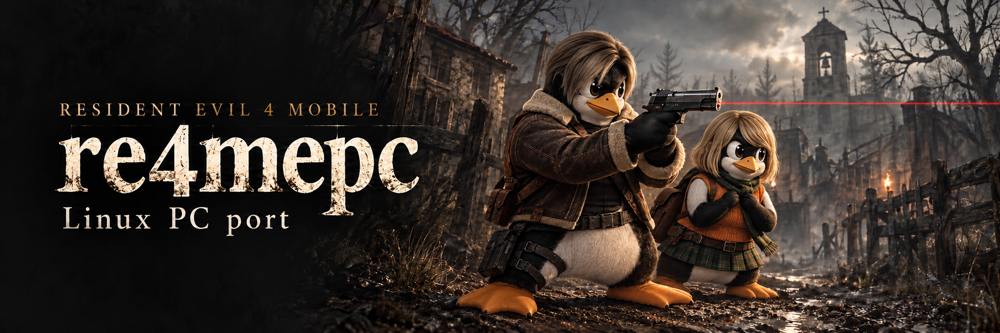
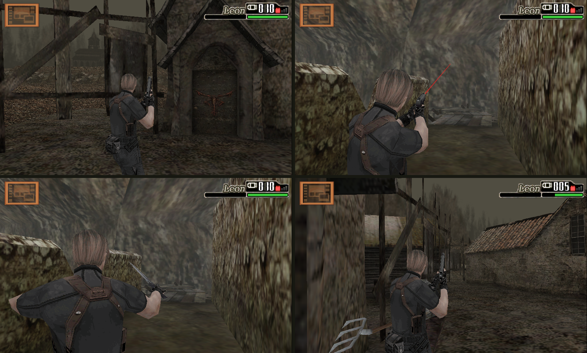
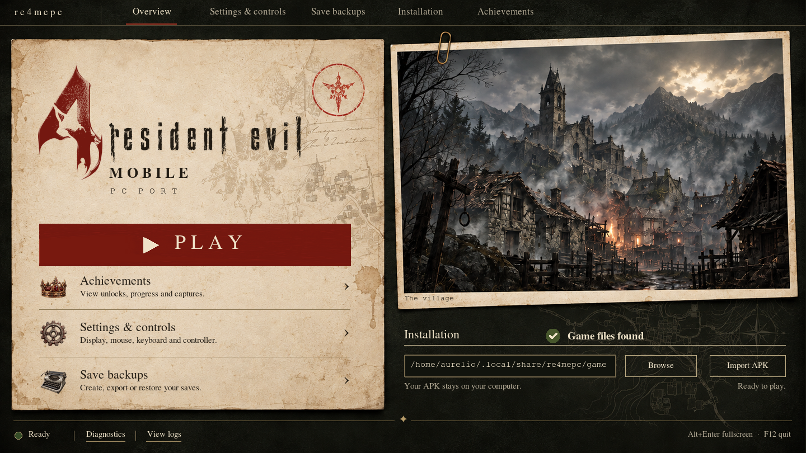
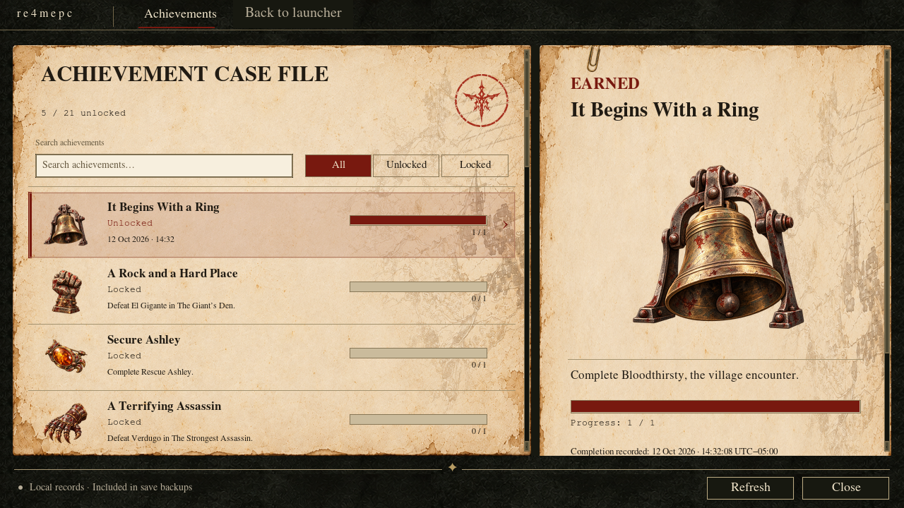
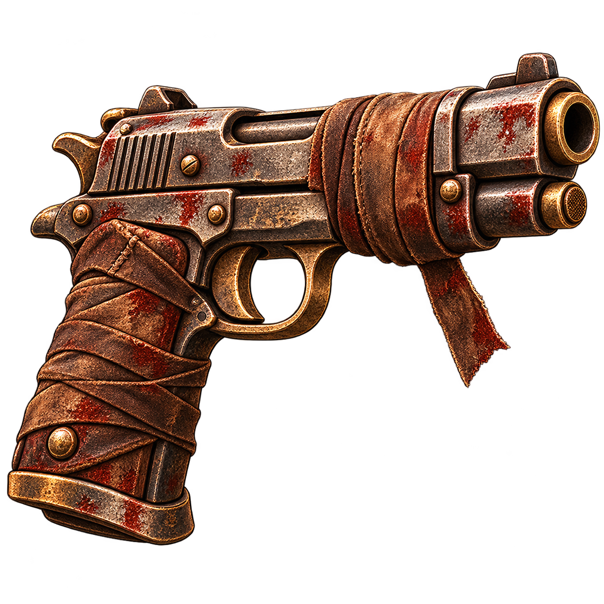
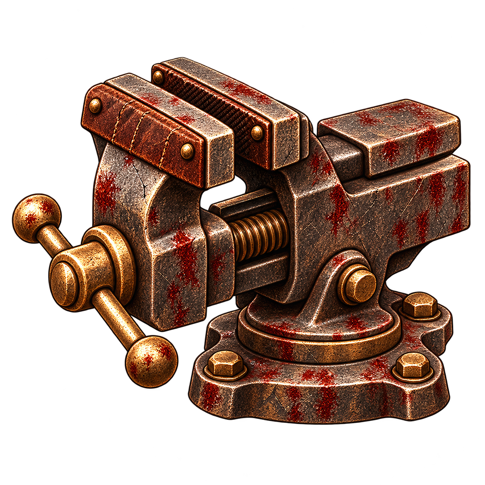

# Resident Evil 4 Mobile on Linux

## About

Play the original ARM32 Android engine in a Linux desktop window with mouse and keyboard controls. **re4mepc** is an experimental compatibility host: Unicorn executes the game's native libraries, SDL2 handles the window and audio, and a graphics bridge translates OpenGL ES 1 rendering to desktop OpenGL.

You supply the APK. The repository contains the host, importer, synthetic tests and documentation; it never downloads the game. Imported libraries, resources, saves and runtime captures stay outside the checkout; the documentation includes selected gameplay screenshots. No Android installation is required.

[Setup](#setup-and-play) · [Graphical launcher](#graphical-launcher) · [Languages](#languages) · [Achievements](#achievements) · [Desktop shortcut](#linux-app-and-desktop-shortcut) · [Portable builds](#portable-builds) · [Controls](#controls) · [Save backups](#save-backups) · [Development](#development-and-testing) · [Español](#español)

## Gameplay gallery



Actual **re4mepc** gameplay captured during Linux desktop tests. Clockwise from the top left: village exploration, handgun aiming, village gameplay and knife stance. Each frame preserves the original 800 × 480 game image. Game artwork © Capcom. The generated Tux banner's references and prompts are documented in [Banner artwork](docs/banner-artwork.md).

## Status and limitations

Linux x86_64 is the target. Shared guest memory requires a mapping below 4 GiB, and the renderer requires desktop OpenGL compatibility functions. Controllers, resizing, HiDPI and borderless fullscreen are implemented. Windows, macOS and ARM64 Linux are outside this release.

The title, English menus, original video and audio, and village gameplay have been exercised in visible desktop tests. ARM translation and Python import calls impose substantial overhead, especially during level loading; this is not yet a performance-equivalent native x86 port. A full campaign playthrough has not been validated. See [VALIDATION.md](VALIDATION.md) for the recorded checks and limitations.

Gameplay and presentation run at **20 Hz**, matching the original engine's mission clock. Higher rates also speed up game logic, so 30/60 FPS modes are unavailable. Independent rendering research has not established a safe boundary.

The [experimental prerelease](https://github.com/aurelioochoa/re4mepc/releases/tag/v0.1.0-experimental.20261014) is **not fully campaign-qualified**. The refreshed AppImage/archive include the six-language selectors and bundled Japanese fonts. Their exact hashes pass clean Ubuntu 22.04, Ubuntu 24.04 and Arch smoke/upgrade checks, six-language launcher checks, and input-only first-mission/inventory/save replays on AMD RX 6700S. The Ubuntu 22.04 checks also verify all six native game-language selections in both formats. The current source passes 313 component tests and the source/history audit; the published prerelease’s qualification is recorded separately. Physical controllers, display/HiDPI, audible speakers and extended driver gameplay remain unverified; Intel/NVIDIA hardware was unavailable.

Mission completion is deferred to the user's later playtest. The previous runtime's two-hour soak was stopped after its preserved 2,880.043-second checkpoint and remains incomplete. An intermittent native difficulty-initialization exception remains unresolved. No loading optimization met the performance gate, and the earlier keyboard-aim failure was not reproduced or claimed fixed. See the [qualification summary](docs/qualification-summary.md), [campaign checklist](docs/campaign-coverage.md) and [measured roadmap results](docs/roadmap-results.md).

## Setup and play

Source setup requires Linux **x86_64**, Python 3.10 or later with `venv` and Tk, GNU Make, a C compiler, `pkg-config`, SDL2 development headers, desktop OpenGL with a compatibility profile, and FFmpeg. Portable releases bundle the application dependencies and need the host's graphics drivers. Run from your desktop session with your normal display and audio device available.

On Arch Linux, install `python tk make gcc pkgconf sdl2-compat ffmpeg mesa noto-fonts-cjk`. On Debian/Ubuntu, install `python3-venv python3-tk build-essential pkg-config libsdl2-dev libgl1-mesa-dev ffmpeg fonts-ipafont-gothic`.

```bash
git clone https://github.com/aurelioochoa/re4mepc.git
cd re4mepc
make install
make play
```

`make install` installs only for your user and needs no `sudo` once the system prerequisites are installed. Keep the checkout and its `.venv` in place. For setup without installing a menu entry or CLI, use `make setup` followed by `make play`.

The installed `re4mepc` command works from any directory when `~/.local/bin` is on your `PATH`. If your shell cannot find it, run `export PATH="$HOME/.local/bin:$PATH"` (and add that line to your shell configuration), or use `~/.local/bin/re4mepc`.

| Task | From the checkout | Installed CLI |
| --- | --- | --- |
| Open the launcher | `make play` | `re4mepc` |
| Import your APK | `make import APK="/path/to/game.apk"` | `re4mepc import "/path/to/game.apk"` |
| Validate game data | `make check-game` | `re4mepc check` |
| Start the game directly | `make run` | `re4mepc run` |
| Show settings | `make settings` | `re4mepc settings` |
| Create / list save backups | `make backup` / `make backups` | `re4mepc backup` / `re4mepc backups` |
| Show all CLI commands | `make cli ARGS="--help"` | `re4mepc --help` |

Use `ARGS` for extra CLI options, for example `make run ARGS="--language es"` or `make import APK="/path/to/game.apk" ARGS="--output /external/re4/game"`. `make help` lists targets. `make uninstall` removes the installed CLI, menu entry and icon while preserving game data and saves. Existing shell scripts remain supported.

Choose **Import APK** in the launcher, select your compatible APK and an unused destination folder, then choose **Play** when import completes. To import and run directly from the command line instead:

```bash
re4mepc import '/path/to/Resident Evil 4.apk'
re4mepc check
re4mepc run
```

## Graphical launcher



Open the launcher with `re4mepc`, `make play` or `make launcher`. The native desktop UI pairs an aged parchment case file with a pinned village photograph, a distressed red numeral and a textured Play button. Top navigation and the full settings and backup rows support mouse and keyboard activation. Progress and Stop appear during operations. [Artwork prompts and provenance](docs/launcher-assets.md) document the generated assets.

1. **Import APK** restores your game into a new folder. The launcher suggests an unused destination and switches to it only after import succeeds.
2. **Browse** selects an existing imported installation. Play becomes available when the expected files are present; the engine performs full validation when it starts.
3. **Play** opens the game window. The launcher shows the running state and provides **Stop** to end the active operation.

### Languages

Use the **Game language** and **Launcher language** dropdowns below the village photograph. Both offer **English, Spanish, French, German, Italian and Japanese**.

| Selector | When it applies |
| --- | --- |
| **Launcher language** | Immediately, including open settings, achievements and backup windows. Unsaved settings edits are preserved. |
| **Game language** | On the next game launch. Choose **Use game's saved language** to leave language selection to the original engine. |

The two choices are saved independently in `~/.config/re4mepc/settings.json` (or `$XDG_CONFIG_HOME/re4mepc/settings.json`). For example, you can use a French launcher with an English game.

Override the game preference for a single session from the terminal:

```bash
re4mepc run --language es
re4mepc run --language saved
```

The supported codes are `en`, `es`, `fr`, `de`, `it`, `ja` and `saved`. Source installations need Japanese fonts; the setup packages above include them. The current portable prerelease bundles IPAGothic and its license. Older downloads predate these selectors; update to the current prerelease or rebuild with `make package`.

**Settings & controls** configures display options, sensitivity and keyboard, mouse or controller bindings for the next game launch. Sliders and numeric fields stay synchronized; each section scrolls so every binding remains reachable. **Save backups** creates snapshots and imports, exports, restores or deletes selected snapshots while the game is stopped. Restore keeps a recovery copy; deleting a snapshot preserves current saves. The [case-file windows](docs/dialogs.md) share generated parchment, seals and inventory artwork and support keyboard navigation at smaller sizes. **Diagnostics** starts a game session with profile, statistics and runtime log files.

The main window has no console panel. Progress, completion and failures appear in its status area; **View logs** opens optional session output in a separate window. Applications-menu and desktop shortcuts open without a terminal. Direct CLI runs continue to print terminal logs.

Use `re4mepc launcher --game '/external/re4/game'` for a custom installation. See [desktop and release usage](docs/desktop-release.md) for save locations, diagnostics and standalone packages.

### Achievements



<p>
  
  
  
  
</p>

**Achievements** shows 21 local achievements with icons, progress, weapon purchase/tune-up goals and a Platinum for earning all other achievements. The window preview above uses synthetic progress; the badges show **It Begins With a Ring**, **What Are Ya Buying?**, **Custom Made** and **Legend of the Village (Platinum)**. Saved mission completion and S ranks award them automatically; play once to recover progress from existing saves. **Settings & controls → Achievements** configures unlock screenshots or silent replay clips. Captures appear in the achievement gallery, where **Export selected** and **Export all** create ZIPs with original PNG/MP4 files and achievement metadata. Shared files are deduplicated and missing captures are listed. Records are included in save backups; to transfer their referenced media too, enable the unchecked **Include achievement media** option during backup export. See the [achievement list, captures and historical research](docs/achievements.md).

## Linux app and desktop shortcut

`make install` prepares the Python environment, compiles native helpers and installs the `re4mepc` CLI and applications-menu entry with the generated application icon. If you already ran `make setup`, install just the desktop integration with:

```bash
make desktop
```

An existing installed icon is preserved. To use the APK's original icon instead:

```bash
make desktop DESKTOP_ARGS="--apk '/path/to/Resident Evil 4.apk'"
```

The installer chooses the largest PNG named `icon`, `ic_launcher`, `ic_launcher_round`, `app_icon` or `launcher_icon` under the APK's `res/drawable*` or `res/mipmap*` directories. For APKs with other icon names, or to use your own cover image, supply a PNG instead:

```bash
make desktop DESKTOP_ARGS="--icon '/path/to/re4-cover.png'"
```

Launch **Resident Evil 4 Mobile** from your applications menu, or run `~/.local/bin/re4mepc` from any directory. To also place a double-click shortcut on your desktop:

```bash
make desktop DESKTOP_ARGS="--desktop"
```

The desktop folder follows `xdg-user-dir DESKTOP`, including localized folder names. Your desktop may require **Allow Launching** or **Trust this launcher** on first use. If no desktop folder is configured, omit `--desktop` to use the applications menu.

The source installer opens the [graphical launcher](#graphical-launcher) from this checkout and its `.venv`; keep both in place. Reopening an installed source launcher picks up UI changes from the checkout. Standalone AppImage and portable builds require a fresh `make package` build to include application changes; see [release usage](docs/desktop-release.md).

The menu entry and a byte-for-byte copy of the chosen PNG are stored under `~/.local/share/applications/re4mepc.desktop` and `~/.local/share/re4mepc/icons/re4mepc.png`, respecting `XDG_DATA_HOME`. Diagnostic files respect `XDG_STATE_HOME`. APK-derived and custom icons stay local; generated launcher assets are included in the repository. Subsequent `make desktop` calls reuse the installed icon unless you specify `--apk` or `--icon`. If you move the checkout, run the installer again at its new location. For a custom game location, include `--game /external/re4/game` in `DESKTOP_ARGS`.

```bash
make uninstall-desktop                         # Remove menu entry, executable and icon
make uninstall-desktop DESKTOP_ARGS="--desktop" # Also remove the desktop shortcut
```

Uninstalling the launcher preserves the checkout, imported game, saves and logs.

## Portable builds

Download the AppImage or portable archive from the [experimental prerelease](https://github.com/aurelioochoa/re4mepc/releases/tag/v0.1.0-experimental.20261014). It also provides **SHA256SUMS** and the authored qualification summary. Download both packages alongside SHA256SUMS to check the complete pair with `sha256sum -c SHA256SUMS`, or check your chosen package's hash against the [qualification summary](docs/qualification-summary.md). These packages contain no game data and are not fully campaign-qualified.

Build a standalone Linux x86_64 AppImage and portable archive from source with Docker available:

```bash
make setup
make package
```

The Ubuntu 22.04 builder bundles Python/Tk, SDL2, FFmpeg, Python dependencies and the native helpers. Initial packaging needs network access. The outputs are `dist/re4mepc-linux-x86_64.AppImage`, `dist/re4mepc-linux-x86_64.tar.gz` and `dist/SHA256SUMS`. They contain the host and launcher; import your own compatible APK on first use.

To launch a locally built AppImage:

```bash
chmod +x dist/re4mepc-linux-x86_64.AppImage
./dist/re4mepc-linux-x86_64.AppImage
```

If FUSE is unavailable, append `--appimage-extract-and-run`. For the portable archive:

```bash
tar -xzf dist/re4mepc-linux-x86_64.tar.gz -C /path/to/extract
/path/to/extract/re4mepc/AppRun
```

Both formats open the launcher with no arguments and accept the same CLI commands as `re4mepc`. They use external XDG locations for game data, settings and backups, so replacing application files preserves your installation. Host graphics drivers and system runtime libraries remain required. See [package requirements and validation](docs/desktop-release.md) and [current qualification summary](docs/qualification-summary.md).

## Controls

F12 closes the window. PC gameplay controls are enabled by default; the cursor is captured during gameplay and released in menus and story overlays. English is the default language; see [Languages](#languages) for the independent game and launcher selectors and CLI overrides. Enter, Space, Escape, or a mouse click skips a playing video.

| Desktop input | Game input |
| --- | --- |
| W / S | Forward / backward |
| A / D | Turn left / right (classic tank movement) |
| Arrow keys | Same directions; navigate menus |
| Mouse movement | Look and aim with relative mouse movement |
| Hold right mouse / X | Aim |
| Left mouse / Z | Fire |
| R | Reload |
| Hold F, then left mouse / Z | Ready knife, then slash |
| E / Enter / Space | Context action; Enter / Space advance story text |
| Escape | Open status; cancel inventory submenu or return to gameplay |
| Tab | Release / capture cursor; click to recapture |
| F3 | Toggle diagnostics |
| Alt+Enter | Toggle borderless fullscreen |
| F12 | Close the host |

To pick up ammo or another ground item, press Space to select it, then press Space again to take it.

PC mode hides the movement pad and gun, knife, and lower-weapon touch buttons. Contextual actions (pickups, doors, ladders, and other interactions), companion commands, scope controls, status displays, and menus remain visible.

In PC mode, Enter/B continues through recognized menus and confirms the difficulty slider once per press. WASD/D-pad or the right stick moves the menu cursor; Space/A clicks it, including inventory items and their context menus. Escape/Start cancels a recognized inventory submenu, then returns from inventory to gameplay. Current bindings appear on screen. Focus loss, disconnect and menu transitions cancel pending gestures. Ordinary mouse clicks and dragging continue to work. See [desktop menu controls](docs/menu-controls.md). For the original mouse-as-touch controls and their full interface, launch `re4mepc run --controls touch`.

Mouse look uses 0.15 degrees per pixel, with vertical movement limited to
45 degrees up or down. Holding and releasing aim preserves the vertical look
angle. Losing window focus releases held controls and the cursor; click the
game window to recapture it.

Un-aimed mouse look rotates the third-person camera around its native target.
The engine checks walls against that same camera orbit before rendering.

SDL2 controllers use these default bindings:

| Controller input | Action |
| --- | --- |
| Left stick | Forward/backward and tank turns |
| Right stick | Look; move the touch cursor in menus |
| Left / right trigger | Aim / fire |
| A | Context action; click the menu cursor |
| X / Y | Reload / knife |
| Start | Open status; cancel inventory submenu or return to gameplay |
| D-pad | Menu navigation |
| B | Continue or confirm the recognized slider |

Use **Settings & controls** to remap inputs and adjust mouse sensitivity, controller sensitivity, invert Y and stick dead zone. Tab, F3 and F12 are reserved. Explicit `run` options override saved settings, for example `re4mepc run --window-mode fullscreen --controller-sensitivity 2`. Resizing and HiDPI preserve the original 800 × 480 image with letterboxing.

## Save backups

The host snapshots the complete save set before startup and around native saves, retaining the ten latest distinct sets. **Save backups** in the launcher supports manual snapshots, import, export, restore and deletion while the game is stopped. Restore verifies file hashes and preserves a recovery copy of your current saves.

The same operations are available in the CLI:

```bash
re4mepc backup
re4mepc backups
re4mepc export-backup SNAPSHOT_ID '/path/to/save-backup.zip'
re4mepc import-backup '/path/to/save-backup.zip'
re4mepc restore-backup SNAPSHOT_ID
```

Replace `SNAPSHOT_ID` with an ID from `backups`; add `--game /external/re4/game` for another installation. Ordinary snapshots and save-only exports include achievement records but exclude imported resources, caches and media. For a portable save-and-media bundle, add `--include-media`; it exports media referenced by the selected snapshot and fails if a referenced file is missing. Import validates the bundle before publishing an inactive snapshot; use **Restore** to activate it. Identical existing media is reused, while conflicting contents are rejected.

```bash
re4mepc export-backup SNAPSHOT_ID '/path/to/save-and-media.zip' --include-media
re4mepc import-backup '/path/to/save-and-media.zip'
re4mepc export-achievements '/path/to/selected-captures.zip' --achievement village --achievement gigante
re4mepc export-achievements '/path/to/all-captures.zip'
```

Gallery export reports missing captures and deduplicates shared files. Portable bundles allow up to 1 GiB of referenced media and 4,096 media files. See [portable captures](docs/portable-captures.md) and [save storage and recovery](docs/desktop-release.md).

## How the port was made

The port was built around the native engine distributed in the Android APK. The original ARM machine code still handles game logic; the work in this repository supplies the environment it expects and adapts it to a desktop.

1. **Identify the engine and restore its resources.** The importer extracts `libbio4af.so` and `libmc_eruption_for_android_jni.so`, follows the APK's asset manifest and removes packaging-only `.png` suffixes to restore resource names. Both library hashes and the required resources are checked before an import is installed.
2. **Load and link the ARM libraries.** A custom ELF loader maps the libraries into shared memory, reads their exported symbols and applies ARM relocations. Calls to Android or C runtime imports are connected to host implementations. Unicorn executes ARM and Thumb instructions; EABI helpers supply the floating point operations the engine imports.
3. **Implement the Android interfaces the engine uses.** A small JNI layer supplies objects, strings, arrays, native method registration and the requested application services. The host calls the engine's `JNI_OnLoad` and Android lifecycle callbacks directly. Bionic/libc replacements provide memory, file and save operations. Unsupported imports and JNI services fail with an error.
4. **Bridge graphics and media to Linux.** Fixed-function GLES calls are mapped to desktop OpenGL, including expansion of OES paletted textures. FFmpeg decodes the original audio and movies, while SDL2 presents the window and mixes audio. Small C helpers accelerate frequent memory operations and the audio callback.
5. **Add desktop input at the engine's own control points.** SDL keyboard and mouse events feed menus through the original key/touch callbacks. During gameplay, symbol-based hooks translate desktop input into the engine's control state and camera angles. Mouse look adjusts the native camera orbit before its wall-collision checks, and aim transitions preserve vertical look direction.
6. **Check components, then exercise the real engine.** Synthetic tests cover the loader and service bridges without game data. Separate visible tests use a locally imported engine to check startup, rendering, audio, save/load and gameplay controls. Recorded results and remaining gaps are in [VALIDATION.md](VALIDATION.md).

The symbol inspection utility, [tools/disassemble.py](tools/disassemble.py), uses ELF symbols and Capstone to inspect a locally supplied library. Hooks depend on the supported engine's symbol layout and offsets, which is why matching library hashes are required. Original libraries, assets and disassembly dumps are excluded from publication.

## How it works

At startup, the host validates the imported data, allocates shared ARM32 memory, loads and relocates the libraries, runs their constructors and calls their JNI initialization and lifecycle methods. The default window is 800 × 480.

```text
Your APK → local importer → validated ARM libraries + resources
                                      │
                          Unicorn executes the engine
                                      │
                    Imported calls → Linux host bridges
                                      │
                  OpenGL rendering · SDL2 audio · file I/O

Each frame:
SDL2 input → desktop control bridge → engine draw callback
           → movie overlay update → SDL2 window swap
```

The engine sees 32-bit addresses. The host maps a 256 MiB region below 4 GiB into both Unicorn and the Linux process at the same address, letting host bridges read validated guest buffers directly. This shared mapping is one reason the current implementation requires Linux x86_64.

When the engine calls an imported function, an ARM trampoline routes that call to a Python or native C implementation. Rendering calls reach desktop OpenGL; file calls operate on the imported data and save directories; JNI media requests reach the FFmpeg/SDL2 media layer. The host then returns control to the ARM engine. Android's Java application and operating system are replaced by this limited set of services.

The frame loop polls desktop events, applies queued input and camera changes, calls `native_onDrawFrame`, updates audio/movie playback and swaps the window. It caps updates at **20 FPS**, matching the engine's mission clock (20 updates per game second). Each draw advances game logic, so uncapping this engine also accelerates movement, combat and timers. The previous 45 FPS target could run gameplay too fast.

Frame pacing uses absolute deadlines to avoid accumulating sleep drift, and discards missed deadlines after loading stalls so gameplay does not rush to catch up. FFmpeg audio decoding and movie-process cleanup run on workers; first-use sounds play once ready, and stopping or replacing a sound cancels its pending playback. Decoded audio is cached locally, including movie audio. Register arguments are read in batches and paletted textures expand through Pillow's native routines. Initial resource loading still executes inside the ARM engine and can take several seconds; sustained engine frames above 50 ms still slow gameplay. Higher rendering rates require separating and auditing the original engine's update and draw paths.

| Responsibility | Source |
| --- | --- |
| APK restoration and engine validation | [assets.py](re4pc/assets.py) |
| ARM/Thumb execution, ELF loading and relocations | [arm.py](re4pc/arm.py) |
| Android JNI services and lifecycle entry points | [jni.py](re4pc/jni.py), [game.py](re4pc/game.py) |
| C runtime, files and ARM math helpers | [bionic.py](re4pc/bionic.py), [eabi.py](re4pc/eabi.py) |
| GLES rendering and texture conversion | [graphics.py](re4pc/graphics.py), [textures.py](re4pc/textures.py) |
| Keyboard, touch routing and gameplay mouse controls | [input.py](re4pc/input.py), [pc_controls.py](re4pc/pc_controls.py) |
| Native game cadence and frame pacing | [timing.py](re4pc/timing.py) |
| FFmpeg audio/movie decoding and SDL2 mixing | [media.py](re4pc/media.py), [audio.c](native/audio.c) |
| Fast memory imports | [fast.py](re4pc/fast.py), [fast.c](native/fast.c) |
| Desktop launcher and settings | [launcher.py](re4pc/launcher.py), [settings.py](re4pc/settings.py) |
| Named actions and controller routing | [actions.py](re4pc/actions.py), [controllers.py](re4pc/controllers.py) |
| Save snapshots and native save boundaries | [backups.py](re4pc/backups.py), [save_boundary.py](re4pc/save_boundary.py) |
| Local achievements and unlock captures | [achievements.py](re4pc/achievements.py), [achievement_media.py](re4pc/achievement_media.py) |
| Runtime diagnostics and portable packaging | [diagnostics.py](re4pc/diagnostics.py), [packaging.py](re4pc/packaging.py) |

## Data locations and supported engine

The importer restores the bundled files' original names and checks both ARM
libraries and every required stage resource. Extraction is temporary until
validation succeeds. Existing destinations, including empty directories and
symlinks, are never overwritten.

| Content | Default location |
| --- | --- |
| Imported libraries and resources | `~/.local/share/re4mepc/game` |
| User saves | `~/.local/share/re4mepc/game/saves` |
| Achievement screenshots and clips | `~/.local/share/re4mepc/game/achievement-media` |
| Desktop settings | `~/.config/re4mepc/settings.json` |
| Save snapshots | `~/.local/state/re4mepc/backups/<installation-path-hash>` |
| Decoded audio cache | `~/.local/share/re4mepc/game/cache/audio` |
| Experimental converted-texture cache | `~/.cache/re4mepc/textures` |
| Test game copies, captures and measurements | `~/.local/state/re4mepc/logs` |

Absolute `XDG_DATA_HOME`, `XDG_CONFIG_HOME`, `XDG_STATE_HOME` and `XDG_CACHE_HOME` values replace
`~/.local/share`, `~/.config`, `~/.local/state` and `~/.cache`, respectively. Empty or relative values use the defaults.
Explicit paths remain available:

```bash
re4mepc import /path/to/game.apk --output /external/re4/game
re4mepc check --game /external/re4/game
re4mepc run --game /external/re4/game
```

Only the following engine libraries are supported. Import, check and run verify
these SHA-256 values. The APK's overall hash can differ, so repackaged APKs with
the same libraries and complete resources are accepted. There is no runtime
option to bypass engine compatibility validation.

| Library | SHA-256 |
| --- | --- |
| `libbio4af.so` | `6f6e52ef26b096cda44fc08c3f541cdc3bf1056a88f13fc1c3e17201589a0423` |
| `libmc_eruption_for_android_jni.so` | `25109c3b799045312073243b644f6053726689d7baf05bcf09b7acd786cff4f6` |

For an older checkout with local `game/` and `logs/`, run
`.venv/bin/python tools/migrate_local.py` once. It checks both destinations
before moving anything and records file inventories and SHA-256 values in
`~/.local/state/re4mepc/migration.json` (respecting `XDG_STATE_HOME`). It refuses
existing destinations and verifies every moved file. Stop running game
processes before migration. `--verify` later checks all original entries;
new test artifacts are allowed.

## Development and testing

Run `make` to list the available commands. The synthetic suite needs no APK; tests that exercise the real engine open a desktop window and use isolated game copies.

| Command | Purpose |
| --- | --- |
| `make build` | Compile the native memory and audio helpers |
| `make launcher` | Open the graphical launcher with optional logs |
| `make desktop` | Build helpers and install the per-user executable and app shortcut |
| `make uninstall-desktop` | Remove the installed launcher and icon; preserve game data |
| `make run` / `make dev` | Launch the game with live terminal logs |
| `make check` | Build helpers and run synthetic component tests |
| `make verify` | Run component tests and audit the Git index/history |
| `make check-game` | Validate the imported libraries and resources |
| `make visible-test` | Exercise startup, video, menus, rendering, audio and save/load |
| `make controls-test` | Exercise gameplay controls and camera behavior |
| `make package` | Build the Linux x86_64 AppImage and portable archive |
| `make clean` / `make distclean` | Remove build caches / also remove `.venv` |

<details>
<summary>Runtime logs, command options and cleaning</summary>

`make` lists the standard project commands. `make run` (or `make dev`) starts
the game with live terminal status every five seconds: FPS, frame and draw
counts, input count, cursor state, and whether the engine is still loading.
Startup, cursor changes, errors and final statistics are logged immediately.
Verbose original engine messages are available at the debug level.

```bash
make run ARGS="--log-file ~/.local/state/re4mepc/logs/game.log"
make run ARGS="--log-level debug --log-interval 2"
make verify
```

Use `--log-interval 0` to disable periodic status. The log file appends across
runs. Terminal log levels are colored (debug cyan, info green, warnings yellow,
errors red); redirected output and log files stay plain. Set `NO_COLOR=1` to
disable colors or `FORCE_COLOR=1` to enable them even when redirecting output.
`make check` builds helpers and runs synthetic component tests without a game.
`make verify` also audits the Git index and history. Use `make check-game`
(or `re4mepc check`) to validate your imported game. `make clean` removes compiled helpers and Python
caches, and `make distclean` also removes `.venv`; both preserve imported game
data, saves and logs. Run `make build` after cleaning, or `make setup` after
distclean. No automatic formatter is configured, so `make fmt` explains this.

To capture a bounded run and its measurements:

```bash
re4mepc run --frames 600 --screenshot /tmp/frame.png --stats /tmp/stats.json
```

Statistics include the native update rate (`engine_hz`), missed frame deadlines
(`frame_overruns`), elapsed run time, and mean/maximum engine frame time.
F3 toggles the in-game diagnostics overlay. `--profile /tmp/profile.jsonl`
records detailed timing. Converted texture caching is experimental and disabled
by default; use `--cache` to compare it with the default `--no-cache` path.
See [metrics and benchmark definitions](docs/diagnostics.md) and the
[rendering audit](docs/render-audit.md) for measurement limits and the 20 Hz gate.

</details>

<details>
<summary>Component coverage and visible game tests</summary>

```bash
make test
make visible-test
make controls-test
```

`make test` checks APK restoration and rejection of unsafe paths, texture palette decoding, ARM/Thumb execution, floating point helpers, JNI argument alignment, save file I/O, and the native memory bridge, including invalid-pointer rejection and quick press/release sampling. These are component tests; they do not launch a hidden game.

`make visible-test` opens a normal SDL window, plays the original intro, displays the title, clicks through to the menu, and plays audio through the desktop audio device. It creates a fresh game copy with separate saves under the external
`logs/visible-test/run-*/game-*` directory and checks the original engine's save/load routines by saving a language change, changing it in memory, loading it back and restoring the original setting. Captures, the input replay, and measured statistics are written to that run directory. The replay accepts F12 and the window's close button; other desktop input is ignored during this timed test so clicks cannot interrupt its sequence. Rendering, video playback, actual mixed audio output, input delivery and nonblank captures are checked automatically; screenshots still need visual inspection for scene correctness.

`make controls-test` opens the real game window, uses an isolated story mission fixture and checks gameplay controls through SDL events one by one. It measures camera direction as well as player rotation, repeated aim transitions, idle drift, focus release and ammunition. Captures and measurements are saved under the external `logs/pc-controls/run-*` directory. F12 or closing the window interrupts the test.

</details>

<details>
<summary>Interactive test commands</summary>

For an interactive visible test with JSON commands on stdin:

```bash
.venv/bin/python -u tools/live_test.py
```

For example, enter `{"action":"screenshot","path":"/tmp/game.png"}` to capture the window, `{"action":"stats"}` for live measurements, or `{"action":"quit"}` to close it. It creates an isolated game copy with fresh saves; normal mouse and keyboard
events also reach this window. Once a mission is running, `{"action":"test_pc"}` runs visible SDL gameplay checks and writes captures and measurements to its external run directory. During this short test only F12 and close-window input are accepted.

</details>

<details>
<summary>Source audit, CI and test artifact locations</summary>

```bash
make check
make audit-source
make verify
make check-game
make visible-test TEST_ARGS="--game /external/re4/game --output /external/re4/smoke"
```

Visible, gameplay, live and input-probe tests accept `--game` and `--output`.
Their defaults use XDG paths and a new run directory every time. They copy only
libraries and resources; user saves and caches are never used as test fixtures.
Copies use separate files rather than writable hard links. Test output must be
outside the source game directory. Captures and copies can be removed after
review to reclaim disk space.

`make audit-source` checks the Git index, every tree in all refs and reflogs,
and every stored blob, including dangling blobs. It rejects paths outside an
explicit source/documentation allowlist, symlinks, submodules, unapproved binary contents,
and large encoded payloads or disassembly dumps. It also checks past commits
whose forbidden files have been deleted from the tip. Updating the allowed
source inventory requires editing `tools/audit_source.py` and reviewing the
new source. The audit does not replace reviewing source provenance.

CI installs host dependencies, builds the C helpers, runs synthetic tests and
audits the complete fetched history. It needs no APK, game saves or game
captures. Binary distribution packages containing the game are not produced.

The publication allowlist records exact paths and reviewed SHA-256 values for the generated README banner, launcher artwork, host-only launcher, settings and achievements previews, and the requested gameplay mosaic. Altered or unreviewed binary images are rejected. The previous banner SVG remains at `docs/readme-banner.svg`. References and prompts are recorded in [Banner artwork](docs/banner-artwork.md) and [Launcher artwork](docs/launcher-assets.md). The gameplay gallery contains four Linux port captures; imported game assets and other runtime captures stay outside the repository.

</details>

## Español

### Qué es este proyecto

**re4mepc** permite ejecutar el motor original de Resident Evil 4 Mobile para Android en una ventana de Linux, con teclado y ratón. Es un port experimental de compatibilidad: Unicorn ejecuta las bibliotecas ARM32 originales, SDL2 gestiona la ventana y el audio, y un puente convierte las llamadas de OpenGL ES 1 a OpenGL de escritorio. No requiere instalar Android.

Debes proporcionar tu propio APK compatible. El proyecto no descarga ni incluye el juego; sus bibliotecas, recursos y partidas guardadas se almacenan fuera del repositorio.

### Instalación y ejecución

Necesitas Linux **x86_64**, Python 3.10 o posterior con `venv` y Tk, GNU Make, un compilador de C, `pkg-config`, las cabeceras de desarrollo de SDL2, OpenGL de escritorio con perfil de compatibilidad y FFmpeg. Ejecuta el juego desde una sesión de escritorio con pantalla y audio disponibles.

- **Arch Linux:** instala `python tk make gcc pkgconf sdl2-compat ffmpeg mesa noto-fonts-cjk`.
- **Debian/Ubuntu:** instala `python3-venv python3-tk build-essential pkg-config libsdl2-dev libgl1-mesa-dev ffmpeg fonts-ipafont-gothic`.

```bash
git clone https://github.com/aurelioochoa/re4mepc.git
cd re4mepc
make install
make play
```

`make install` prepara el entorno e instala el comando `re4mepc` y la entrada del menú para tu usuario. Conserva el repositorio y su `.venv`. Para preparar sin instalar accesos, usa `make setup`. Si el shell no encuentra `re4mepc`, ejecuta `export PATH="$HOME/.local/bin:$PATH"` o usa `~/.local/bin/re4mepc`. `make help` muestra los comandos; `make import APK="/ruta/al/juego.apk"`, `make check-game` y `make run` permiten importar, comprobar y ejecutar desde el repositorio. `make uninstall` elimina los accesos y el CLI, pero conserva el juego y las partidas.

En el launcher, elige **Import APK**, selecciona tu APK y una carpeta nueva, y pulsa **Play** cuando termine la importación. **Browse** permite elegir una instalación existente. Para importar y ejecutar desde la terminal:

```bash
re4mepc import '/ruta/a/Resident Evil 4.apk'
re4mepc check
re4mepc run
```

El launcher presenta un expediente con pergamino, una fotografía de la aldea e ilustraciones generadas. **View logs** abre los registros de la sesión cuando los necesitas. **Settings & controls** configura la pantalla, las sensibilidades y los controles de teclado, ratón y mando; **Save backups** gestiona las partidas con el juego detenido; **Diagnostics** inicia una sesión con archivos de diagnóstico. El progreso y los errores aparecen en la ventana principal.

**Achievements** muestra 21 logros locales con progreso, fechas, objetivos de compra y mejora de armas y un Platino al obtener los otros 20. Los logros de misiones y rangos se recuperan al cargar partidas existentes; las compras y mejoras cuentan desde que este launcher las observa. En **Settings & controls → Achievements** puedes elegir capturas de pantalla o clips silenciosos. **Export selected** y **Export all** exportan las capturas con sus metadatos y deduplican archivos compartidos. Las copias normales incluyen los registros; activa **Include achievement media** al exportar para incluir los archivos referenciados. Importa el paquete y usa **Restore** para activar la partida. Consulta la [lista de logros](docs/achievements.md).

Ejecuta `make desktop` para crear una aplicación en el menú de Linux con el icono generado, o conservar el icono ya instalado. Usa `make desktop DESKTOP_ARGS="--apk '/ruta/al/juego.apk'"` para elegir el icono original del APK, o `--icon '/ruta/a/portada.png'` para usar otra imagen PNG. Añade `--desktop` para crear también un acceso directo en el escritorio. Estos accesos abren el launcher sin una terminal.

El ejecutable `~/.local/bin/re4mepc` utiliza este repositorio y su `.venv`; conserva ambos en su ubicación. Para quitar los accesos e icono, usa `make uninstall-desktop DESKTOP_ARGS="--desktop"`; el juego y las partidas se conservan.

`make package` crea un AppImage y un archivo portátil para Linux x86_64 con Docker y una base Ubuntu 22.04. Incluyen las dependencias de la aplicación; debes importar tu propio APK. Ambos abren el launcher sin argumentos y conservan los datos externos al actualizar. La [preversión experimental](https://github.com/aurelioochoa/re4mepc/releases/tag/v0.1.0-experimental.20261014) incluye los selectores de seis idiomas y fuentes japonesas. Pasa pruebas automatizadas de inicio y actualización en Ubuntu 22.04, Ubuntu 24.04 y Arch, y una repetición de entrada a la primera misión e inventario en AMD RX 6700S. No está completamente validada para la campaña. Consulta los hashes y el alcance en el [resumen de calificación](docs/qualification-summary.md). Consulta [Portable builds](#portable-builds) y la [documentación de distribución](docs/desktop-release.md).

La importación verifica las dos bibliotecas y todos los recursos necesarios antes de instalar los datos. Solo se admite el motor con los hashes indicados en [Data locations and supported engine](#data-locations-and-supported-engine). Un APK reempaquetado puede funcionar si conserva esas bibliotecas y los recursos completos. El importador no sobrescribe destinos existentes, aunque estén vacíos.

### Controles

| Entrada | Acción |
| --- | --- |
| W / S | Avanzar / retroceder |
| A / D | Girar a izquierda / derecha, con movimiento clásico tipo tanque |
| Flechas | Mismas direcciones; navegar por los menús |
| Mover el ratón | Mirar y apuntar |
| Mantener botón derecho / X | Apuntar |
| Botón izquierdo / Z | Disparar |
| R | Recargar |
| Mantener F y pulsar botón izquierdo / Z | Preparar el cuchillo y atacar |
| E / Enter / Espacio | Acción contextual; Enter / Espacio avanzan el texto |
| Escape | Abrir estado; cancelar submenú de inventario o volver al juego |
| Tab | Liberar / capturar el cursor; hacer clic para capturarlo de nuevo |
| F3 | Mostrar / ocultar los diagnósticos |
| Alt+Enter | Alternar la pantalla completa sin bordes |
| F12 | Cerrar la ventana |

En modo PC, Enter/B continúa en los menús reconocidos y confirma el deslizador con una sola pulsación. WASD/D-pad o el stick derecho mueve el cursor; Espacio/A selecciona objetos y opciones del inventario. Escape/Start cancela el submenú del inventario y permite volver al juego. También puedes usar el ratón. Enter, Espacio, Escape o un clic omiten el vídeo en reproducción. Al perder el foco, la ventana libera las teclas y el cursor.

Para recoger munición u otro objeto del suelo, pulsa Espacio para seleccionarlo y vuelve a pulsarlo para recogerlo. Los mandos usan el stick izquierdo para moverse y girar, el derecho para mirar, los gatillos para apuntar y disparar, A para interactuar, X para recargar, Y para el cuchillo y Start para el menú de estado. En los menús, mueve el cursor con el stick derecho o D-pad y pulsa A para seleccionar; B continúa o confirma el deslizador. Puedes cambiar las asignaciones en **Settings & controls**.

Los selectores **Idioma del juego** e **Idioma del lanzador**, debajo de la fotografía de la aldea, ofrecen inglés, español, francés, alemán, italiano y japonés. El idioma del lanzador cambia de inmediato, incluidas las ventanas abiertas, y conserva los cambios de ajustes sin guardar. El idioma del juego se aplica al iniciar el juego; **Usar idioma guardado del juego** deja la selección al motor original. Ambas preferencias se guardan por separado en `~/.config/re4mepc/settings.json` y respetan `XDG_CONFIG_HOME`.

El inglés es el valor inicial. Usa, por ejemplo, `re4mepc run --language es` para cambiar el idioma del juego solo durante esa ejecución; los códigos admitidos son `en`, `es`, `fr`, `de`, `it`, `ja` y `saved`. Las nuevas compilaciones portátiles incluyen IPAGothic y su licencia para mostrar japonés. Para incorporar estos cambios a un AppImage o archivo portátil existente, vuelve a compilarlo con `make package`. Para usar el ratón como pantalla táctil, ejecuta `re4mepc run --controls touch`.

### Cómo se hizo el port y cómo funciona

El trabajo consistió en restaurar los archivos del APK, cargar las bibliotecas ELF de ARM y conectar sus llamadas externas con implementaciones para Linux. Se implementaron los servicios JNI que solicita el motor, operaciones de archivos y memoria, funciones matemáticas de ARM, el puente gráfico y la reproducción de audio y vídeo. Los controles de escritorio se añadieron mediante hooks basados en los símbolos y offsets del motor compatible.

Al arrancar, el host valida los datos, carga y enlaza las bibliotecas en una región de memoria compartida de 256 MiB situada por debajo de 4 GiB y llama a las funciones de inicialización y ciclo de vida originales. Unicorn ejecuta el código ARM/Thumb. Cuando el motor solicita un servicio externo, el host atiende la llamada en Python o C y devuelve el control al motor.

En cada fotograma, SDL2 recoge las entradas, el puente aplica los controles y ajustes de cámara, el motor ejecuta `native_onDrawFrame`, el host actualiza el vídeo y presenta la imagen. El ratón modifica la órbita de la cámara antes de las comprobaciones de colisión del propio motor.

El ritmo se limita a **20 Hz**, porque cada dibujo también actualiza la lógica del juego. Subirlo acelera el movimiento, el combate y los temporizadores; los modos de 30/60 FPS permanecen deshabilitados. La carga de recursos puede causar pausas, y fotogramas que tardan más de 50 ms ralentizan el juego.

### Datos, pruebas y limitaciones

Por defecto, los datos están en `~/.local/share/re4mepc/game`, las partidas en su subdirectorio `saves` y la caché de audio en `cache/audio`. Los registros y capturas de pruebas están en `~/.local/state/re4mepc/logs`. Se respetan `XDG_DATA_HOME` y `XDG_STATE_HOME` cuando contienen rutas absolutas. Puedes indicar otra ubicación con `--output` al importar y `--game` al comprobar o ejecutar.

Los ajustes se guardan en `~/.config/re4mepc/settings.json` y las copias de seguridad en `~/.local/state/re4mepc/backups`, separadas por instalación. Se respeta también `XDG_CONFIG_HOME`. Con el juego detenido, `re4mepc backup` crea una copia y `re4mepc backups` muestra sus IDs; `restore-backup ID` restaura una copia tras verificarla y conservar una copia de recuperación.

- `make check` compila los helpers y ejecuta pruebas sintéticas sin necesitar el juego.
- `make verify` añade la auditoría de fuentes e historial Git.
- `make check-game` valida tu importación.
- `make visible-test` y `make controls-test` abren una ventana real y usan copias aisladas con partidas propias.

Se han probado el título, los menús en inglés, el audio y vídeo originales y el juego en la aldea. La finalización de misiones queda para una prueba posterior del usuario. La campaña completa sigue sin validarse; la prueba final de dos horas se detuvo tras 2.880,043 segundos y permanece incompleta. Sigue sin resolverse una excepción intermitente al inicializar el menú de dificultad. Las pruebas actuales del código fuente pasan 312 casos; faltan las comprobaciones físicas de mando, pantalla/HiDPI y altavoces. La ejecución ARM y las llamadas a Python añaden sobrecarga, especialmente al cargar niveles. Los mandos, el redimensionado, HiDPI y la pantalla completa sin bordes están implementados. Windows, macOS y Linux ARM64 quedan fuera de esta versión. Consulta [VALIDATION.md](VALIDATION.md) para los resultados y límites registrados.

El código del host tiene licencia MIT; esa licencia excluye los datos originales del juego, las marcas y las dependencias de terceros.

## License

The source written for this host is MIT licensed. The license excludes original
game data, trademarks and third-party dependencies. Interoperability names,
symbols, offsets and hashes identify the supported engine; executable test
snippets are hand-written synthetic fixtures and host ABI trampolines.
