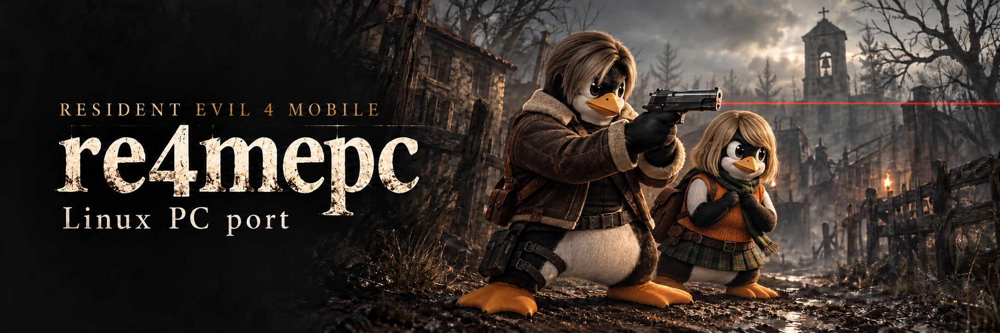
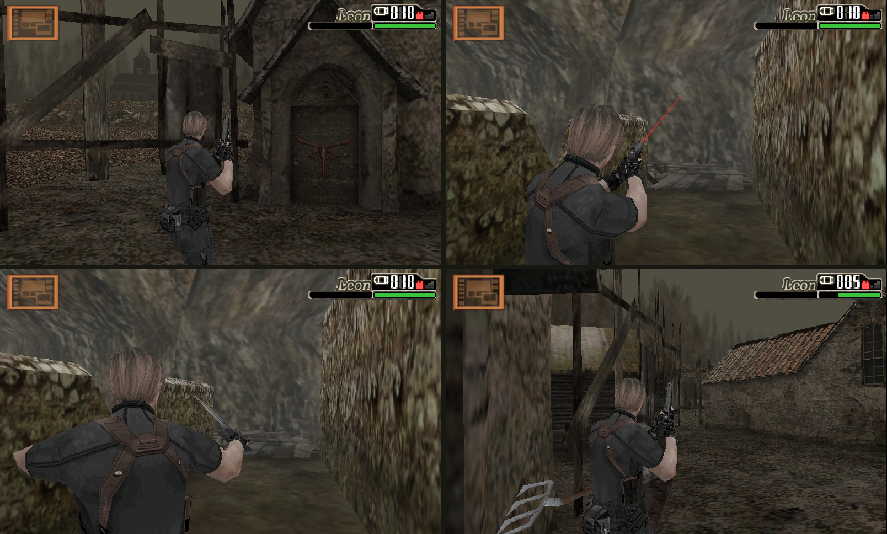
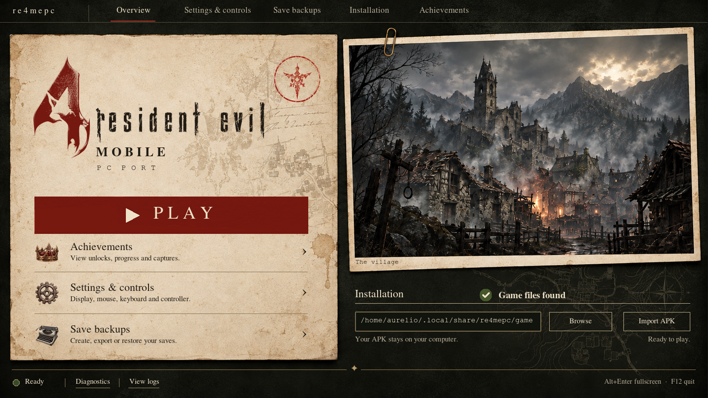

# Resident Evil 4 Mobile PC Port

[English](#english) · [Español](#español)

## English

> **Disclaimer:** `re4mepc` is not a decompilation or a static recompilation of Resident Evil 4 Mobile. It is an effort to preserve the specific Android release identified by the supported library hashes and make that release playable on PC: Linux x86_64, Windows x64 and macOS (Apple Silicon and Intel). Unicorn executes the original ARM32 libraries at runtime; Python/C bridges supply Android services, desktop controls, graphics and audio. You must supply your own compatible APK. Full campaign playability remains unverified.



Play the original **Resident Evil 4 Mobile Android** engine in a desktop window on **Linux, Windows or macOS** with keyboard, mouse and controller support. `re4mepc` is an experimental compatibility host: Unicorn executes the ARM32 libraries, SDL2 handles the window and audio, and a bridge maps OpenGL ES 1 to desktop OpenGL. No Android installation is required.

**Bring your own game:** supply a compatible APK. The project does not include or download the game. Imported libraries, resources and saves stay outside the checkout. Full campaign completion has not been validated.

[Gameplay](#gameplay) · [Downloads](#downloads) · [Quick start](#quick-start) · [FPS and performance](#fps-and-performance) · [Game files](#game-files) · [How the port works](#how-the-port-works) · [Controls](#controls) · [Development](#development)

### Gameplay



Actual Linux desktop captures; each frame preserves the original **800×480** game image. Clockwise from the top left: exploration, handgun aiming, village gameplay and knife stance. Game artwork © Capcom. The banner is generated artwork; see [references and prompts](docs/banner-artwork.md).

### Downloads

Ready-to-run builds for every platform are on the [**experimental release page**](https://github.com/aurelioochoa/re4mepc/releases/tag/v0.2.0-experimental.20261106). They contain no game data: open the launcher, choose **Import APK** and select your own compatible APK.

| Platform | File | How to start |
| --- | --- | --- |
| **Windows 10/11 x64** | `re4mepc-v0.2.0-experimental.20261106-windows-x64.zip` | Extract the whole folder and run `re4mepc.exe`. `re4mepc-cli.exe` accepts the CLI commands below. |
| **macOS 11+ Apple Silicon** | `re4mepc-v0.2.0-experimental.20261106-macos-arm64.zip` | Unzip and open **Resident Evil 4 Mobile.app**. |
| **macOS 11+ Intel** | `re4mepc-v0.2.0-experimental.20261106-macos-x64.zip` | Same as Apple Silicon. |
| **Linux x86_64** | `re4mepc-v0.2.0-experimental.20261106-linux-x86_64.AppImage` or `.tar.gz` | See [portable builds](#portable-builds). |

Check downloads against `SHA256SUMS` on the release page. The Windows and macOS builds are not signed by a paid certificate:

- **Windows:** if SmartScreen warns, choose **More info → Run anyway**. Keep `re4mepc.exe` next to its `runtime` folder.
- **macOS:** the app is ad-hoc signed but not notarized. The first time, right-click the app and choose **Open** (or **System Settings → Privacy & Security → Open Anyway**), or run `xattr -dr com.apple.quarantine "Resident Evil 4 Mobile.app"`. For the CLI, run `"Resident Evil 4 Mobile.app/Contents/MacOS/re4mepc" --help`.

Each build bundles Python, the emulator libraries, SDL2 and FFmpeg; only a desktop OpenGL driver is needed (OpenGL 2.1 on macOS). On macOS, guest memory cannot sit below 4 GiB, so the host translates every guest address by a fixed offset; on Windows and Linux the shared mapping keeps identical addresses. The Windows and macOS packages pass the same automated component tests on GitHub's Windows, macOS arm64 and macOS Intel runners as Linux, and the macOS memory layout was replayed from the title screen into village gameplay on Linux with every native math call cross-checked against the original code. **Hands-on gameplay on real Windows and Mac hardware has not been verified yet**; please report what you find in an issue.

### Requirements

- **Linux x86_64** with a graphical desktop, audio device and desktop **OpenGL compatibility profile**.
- **Python 3.10+**, `venv`, Tk, GNU Make, a C compiler, Rust (`cargo`), `pkg-config` and SDL2 development headers for source installations.
- **FFmpeg** for original audio and movies. Japanese text needs suitable fonts.

On **Arch Linux**, install `python tk make gcc rust pkgconf sdl2-compat ffmpeg mesa noto-fonts-cjk`. On **Debian/Ubuntu**, install `python3-venv python3-tk build-essential cargo pkg-config libsdl2-dev libgl1-mesa-dev ffmpeg fonts-ipafont-gothic`.

These requirements apply to source installations on Linux. Portable releases bundle application dependencies, including Japanese fonts on Linux; host graphics drivers and system runtime libraries remain required. Windows and macOS use the [downloads](#downloads) above; see [building on Windows and macOS](#building-on-windows-and-macos) to compile them yourself. Linux ARM64 is not supported.

### Quick start

Install the system prerequisites above, then:

```sh
git clone https://github.com/aurelioochoa/re4mepc.git
cd re4mepc
make install
make play
```

`make install` prepares the environment and installs the CLI and applications-menu entry for your user. Keep the checkout and `.venv` in place. For setup without desktop integration, use `make setup` followed by `make play`.

In the launcher, choose **Import APK**, select your compatible APK and an unused destination folder, then choose **Play** when import completes. For direct terminal use:

```sh
re4mepc import "/path/to/Resident Evil 4.apk"
re4mepc check
re4mepc run
```

If the command is not found, add `~/.local/bin` to `PATH` with `export PATH="$HOME/.local/bin:$PATH"`, or run `~/.local/bin/re4mepc`. From the checkout, use `make import APK="/path/to/game.apk"`, `make check-game` and `make run`.

#### FPS and performance

After updating the checkout, rebuild the native helpers and select a presentation rate:

```sh
make build
make run ARGS="--fps 60"
```

Use `--fps 120` for a 120 FPS target, `--fps 0` for uncapped presentation, or `--fps 20` for the original mode. The launcher's **Settings & controls → Display & sensitivity → Presentation rate** saves your choice for future launches; command-line overrides apply to one session.

Higher FPS uses geometry interpolation while gameplay stays at **20 Hz**, with up to **50 ms** of added visual latency. The local test held 60/120 presentation FPS and measured **10.5% less tick work** through the native GL bridge. Uncapped rendering slowed simulation under contention in that test. Rust replacements for the engine's hottest float and collision routines, plus direct VFP float comparisons, cut median gameplay tick work from about **42 ms to under 14 ms** of the 50 ms budget, verified call for call against the original code. Camera turns now retain interpolation as objects enter or leave view, with compatibility checks performed once per native tick. See [the FPS guide](docs/fps-performance.md) for all rates, saved-setting commands, measurements and verification. The packages in the [current release](https://github.com/aurelioochoa/re4mepc/releases/tag/v0.2.0-experimental.20261106) include this feature; the October 2026 packages predate it.

#### Graphics quality

Settings & controls → **Graphics** adds internal resolution scaling up to 4×, MSAA, trilinear/anisotropic texture filtering, sharpen/FXAA/pixel/CRT display filters and experimental 16:9 or 21:9 widescreen. The HUD and menus keep their original 5:3 layout. For example, `make run ARGS="--render-scale 2 --msaa 4 --texture-filtering anisotropic"`. Original game assets are unchanged. See [the graphics guide](docs/graphics-quality.md).

#### Portable builds

The [experimental release](https://github.com/aurelioochoa/re4mepc/releases/tag/v0.2.0-experimental.20261106) provides a Linux AppImage and portable archive alongside the Windows and macOS builds, with `SHA256SUMS`. The [qualification summary](docs/qualification-summary.md) records the checks run on the earlier October 2026 packages, which are no longer published. These packages contain no game data and are not fully campaign-qualified.

Make the AppImage executable and run it; if FUSE is unavailable, add `--appimage-extract-and-run`. For the archive, extract it and run `re4mepc/AppRun`. Both open the launcher without arguments and accept the same CLI commands as `re4mepc`. Build them with `make setup` and `make package` using Docker. See [portable build instructions](docs/advanced-usage.md#portable-builds) and [distribution requirements](docs/desktop-release.md).

#### Building on Windows and macOS

The [`Portable builds` workflow](.github/workflows/portable.yml) builds, tests and packages all four targets from one commit; pushing a `v*` tag publishes them as a prerelease. To build locally:

- **macOS:** install Xcode command-line tools, Rust and Python 3.10+, then `pip install -r requirements.txt` and `python tools/build_native.py` (SDL2 from Homebrew via `pkg-config`, or `RE4PC_SDL2_INCLUDE` plus `RE4PC_SDL2_LIBRARY` pointing at the official SDL2 framework). On Apple Silicon, copy Homebrew's `libkeystone.dylib` into the installed `keystone` package because PyPI has no arm64 wheel. Run with `python -m re4pc`.
- **Windows:** install Python 3.10+, Rust, MinGW-w64 `gcc` and the [SDL2 MinGW development package](https://github.com/libsdl-org/SDL/releases), set `RE4PC_SDL2_INCLUDE` to its `include\SDL2` folder and `RE4PC_SDL2_LIBRARY` to its `SDL2.dll`, then `pip install -r requirements.txt`, `python tools\build_native.py` and `python -m re4pc`. Put `ffmpeg.exe` on `PATH` or in `build\`.
- **Packages:** `python tools/package_portable.py --python <relocatable CPython> --ffmpeg <static ffmpeg> --version <tag>` on the target OS, as the workflow does.

### Game files

The importer restores the APK's resources and verifies both ARM libraries and every required stage resource before installing. It never overwrites an existing destination, even an empty directory. Repackaged APKs may work if they contain the same libraries and complete resources.

| Supported library | SHA-256 |
| --- | --- |
| `libbio4af.so` | `6f6e52ef26b096cda44fc08c3f541cdc3bf1056a88f13fc1c3e17201589a0423` |
| `libmc_eruption_for_android_jni.so` | `25109c3b799045312073243b644f6053726689d7baf05bcf09b7acd786cff4f6` |

Import, check and run enforce these hashes. Use `re4mepc import "/path/to/game.apk" --output /external/re4/game` to select another location, then pass `--game /external/re4/game` to check or run. See [engine validation and migration](docs/advanced-usage.md#data-locations-and-supported-engine).

### How the port works

The original Android ARM32 libraries still execute the game logic. A Python host replaces the Android services they use, **Unicorn** executes ARM/Thumb instructions, and native C helpers handle frequent memory operations and audio mixing.

1. **Restore and load the engine.** The importer extracts `libbio4af.so` and `libmc_eruption_for_android_jni.so`, restores resource names from the APK and verifies the supported library hashes. A custom ELF loader maps the libraries, applies ARM relocations and resolves imported symbols to host functions.
2. **Share memory and supply Android services.** A **256 MiB** mapping below 4 GiB uses the same addresses in Unicorn and the host process on Linux and Windows, allowing host bridges to access validated guest buffers directly. macOS reserves the low 4 GiB, so there the mapping sits elsewhere and Python, C and Rust bridges add one fixed offset to every guest address ([`platform_memory.py`](re4pc/platform_memory.py)). ARM trampolines dispatch imported calls to Python or C. A limited JNI implementation supplies objects, strings, arrays and native method registration; the host runs library constructors, `JNI_OnLoad` and lifecycle callbacks. Bionic/libc and EABI bridges provide files, saves, allocation and imported math helpers.
3. **Bridge graphics and media.** Fixed-function OpenGL ES 1 calls map to desktop OpenGL's compatibility profile; OES paletted textures are expanded before upload. SDL2 supplies the window, input and audio output. FFmpeg decodes original sounds and movies, with decoded audio cached locally and mixed through a native callback.
4. **Feed the original controls.** Menus receive the engine's key/touch callbacks. During gameplay, hooks tied to the supported engine's symbols translate keyboard, mouse and controller actions into its control state and camera angles. Mouse look adjusts the native camera orbit before wall-collision checks. File services route native saves to the installation's save directory, with host snapshots around save boundaries.
5. **Preserve the engine clock and unlock presentation.** Updates run at **20 Hz** because each native draw also advances game logic. Select 30/60/90/120/144/165/240 FPS or Uncapped in Settings, or run `make run ARGS="--fps 60"`. A separate GL context interpolates copied geometry while the emulator works; it adds up to 50 ms of visual latency without accelerating gameplay. Native C imports reduce graphics bridge overhead. [Implementation and measurements](docs/fps-performance.md).

Source entry points: [ARM/ELF runtime](re4pc/arm.py), [JNI](re4pc/jni.py), [lifecycle and frame loop](re4pc/game.py), [graphics](re4pc/graphics.py), [desktop controls](re4pc/pc_controls.py), and [media](re4pc/media.py). See the [architecture reference](docs/advanced-usage.md#how-it-works) for the full source map. Engine-specific symbols, offsets and service coverage limit compatibility to the validated libraries; full campaign support remains unverified.

### Launcher



Open it with `re4mepc`, `make play` or `make launcher`.

- **Import APK / Browse:** import into a new folder or select an existing installation.
- **Play / Stop:** start the game or stop the active operation.
- **Settings & controls:** configure display, keyboard, mouse, controllers and laser sight; changes apply on the next launch.
- **Save backups:** create, import, export, restore or delete snapshots while the game is stopped.
- **Diagnostics / View logs:** collect measurements or inspect optional session output.

The launcher supports mouse and keyboard navigation and adapts down to 640×520. See [launcher behavior](docs/advanced-usage.md#graphical-launcher), [settings and backup windows](docs/dialogs.md), and [artwork provenance](docs/launcher-assets.md).

#### Languages

**Game language** and **Launcher language** independently offer **English, Spanish, French, German, Italian and Japanese**. Launcher changes apply immediately, including open dialogs; game changes apply on the next launch. **Use game's saved language** preserves the engine's own selection. Both preferences persist in `settings.json`.

For a single session, use `re4mepc run --language es` or `--language saved`. Supported codes are `en`, `es`, `fr`, `de`, `it`, `ja` and `saved`. Current portable builds bundle IPAGothic and its license; older packages need updating or rebuilding. See [language details](docs/advanced-usage.md#languages).

#### Achievements

**Achievements** displays 21 local goals, including mission/rank progress, weapon purchases and tune-ups, and a Platinum for earning the other 20. Existing saves recover mission and rank progress after play; purchases and tune-ups count when observed by the launcher.

**Settings & controls → Achievements** enables unlock screenshots or silent replay clips. The gallery exports selected or all captures with metadata and deduplicates shared files. Achievement records are part of save backups; referenced media requires **Include achievement media** during export. See [achievement coverage](docs/achievements.md) and [portable captures](docs/portable-captures.md).

#### Desktop integration

`make desktop` installs or refreshes the applications-menu entry. Use **Launcher icon** in the launcher to choose artwork or your own PNG; the selection also updates installed shortcuts. Add `DESKTOP_ARGS="--desktop"` for a desktop shortcut; `--apk '/path/to/game.apk'` or `--icon '/path/to/icon.png'` also chooses a local icon. Existing installed icons are preserved by default. `make uninstall` removes the CLI and desktop integration while preserving game data and saves. See [desktop installation details](docs/advanced-usage.md#linux-app-and-desktop-shortcut).

### Controls

| Input | Action |
| --- | --- |
| W / S | Forward / backward |
| A / D | Turn left / right (classic tank movement) |
| Arrows | Same directions; menu navigation |
| Mouse movement | Look and aim |
| Hold right mouse / X | Aim |
| Left mouse / Z | Fire |
| R | Reload |
| Double-tap a direction while aiming | Sidestep, then aim again |
| Double-tap S / Down | Quick turn |
| Hold F, then left mouse / Z | Ready knife, then slash |
| E / Enter / Space | Context action; Enter / Space advance story text |
| Escape | Open status; cancel inventory submenu or return to gameplay |
| Tab | Release / capture cursor |
| F3 | Toggle diagnostics |
| Alt+Enter | Toggle borderless fullscreen |
| F12 | Close the game window |

To pick up a ground item, press Space to select it and again to take it. PC mode hides the main touch controls and captures the cursor during gameplay; Tab frees it, and a scene click recaptures without firing. Contextual actions, companion commands, scope controls, status and menus remain visible. Losing focus releases held inputs. Enter, Space, Escape or a click skips a video.

Menus are browsed like a console game: WASD, arrows, D-pad or the left stick move a blood-red focus outline between the game's own buttons and list rows (hold to repeat; lists scroll), Left/Right adjusts a focused counter such as difficulty, Enter/Space/A/B presses the focused control (a confirmation slider is dragged for you), and Escape/Start cancels or returns. There is no on-screen pointer or hint bar. The mouse clicks as usual and hides the focus until the next key or button press.

Controllers use left stick for movement/tank turns, right stick for look, triggers for aim/fire, A for action, X for reload, Y for knife and Start for status; double-flick the stick for sidesteps and the quick turn. Physical controller behavior remains unverified. Remap inputs and sensitivities in **Settings & controls**; Tab, F3 and F12 are reserved. Use `re4mepc run --controls touch` for original touch input. See [full controls](docs/advanced-usage.md#controls) and [menu behavior](docs/menu-controls.md).

### Saves and settings

| Content | Default location |
| --- | --- |
| Imported game | `~/.local/share/re4mepc/game` |
| Saves | `~/.local/share/re4mepc/game/saves` |
| Achievement screenshots/clips | `~/.local/share/re4mepc/game/achievement-media` |
| Settings | `~/.config/re4mepc/settings.json` |
| Save snapshots | `~/.local/state/re4mepc/backups/<installation-path-hash>` |
| Audio cache | `~/.local/share/re4mepc/game/cache/audio` |
| Experimental texture cache | `~/.cache/re4mepc/textures` |
| Diagnostics and test artifacts | `~/.local/state/re4mepc/logs` |

Absolute `XDG_DATA_HOME`, `XDG_CONFIG_HOME`, `XDG_STATE_HOME` and `XDG_CACHE_HOME` override the base directories; empty or relative values use defaults. Replacing portable application files preserves external data.

On **Windows**, `~/.local/share` and `~/.local/state` become `%LOCALAPPDATA%` (for example `%LOCALAPPDATA%\re4mepc\game`), settings live in `%APPDATA%\re4mepc\settings.json` and caches in `%LOCALAPPDATA%\cache`. On **macOS**, data, logs, backups and settings live under `~/Library/Application Support/re4mepc` and caches under `~/Library/Caches/re4mepc`.

The host snapshots saves before startup and around native saves, retaining ten distinct sets. With the game stopped:

```sh
re4mepc backup
re4mepc backups
re4mepc export-backup SNAPSHOT_ID "/path/to/backup.zip"
re4mepc import-backup "/path/to/backup.zip"
re4mepc restore-backup SNAPSHOT_ID
```

Use an ID listed by `backups`. Import creates an inactive snapshot; restore activates it after verification and keeps a recovery copy. Add `--include-media` when exporting to include referenced achievement captures. See [backup operations](docs/advanced-usage.md#save-backups) and [storage and recovery](docs/desktop-release.md).

### Status and limitations

Linux x86_64 is the primary, hands-on validated target. Windows x64 and macOS builds pass the automated component tests on their own CI runners, but gameplay on real Windows and Mac hardware is not yet verified (see [downloads](#downloads)). The host needs 256 MiB of guest memory, mapped below 4 GiB where the OS allows it, and OpenGL compatibility functions (a legacy OpenGL 2.1 context on macOS). Resizing, HiDPI, controllers and borderless fullscreen are implemented, but physical controllers, display/HiDPI and audible speakers still lack qualification.

Visible tests have exercised the title, English menus, original audio/video and village gameplay. Simulation remains **20 Hz**; optional independent geometry interpolation unlocks higher presentation FPS. Native 20 FPS remains the default. ARM execution still limits simulation throughput, especially during loading. Higher display FPS does not increase input or simulation sampling rates.

**Full campaign completion is unverified.** The earlier two-hour soak stopped at its preserved 2,880.043-second checkpoint and remains incomplete. An intermittent native difficulty-initialization exception is unresolved; no loading optimization met the performance gate.

The experimental packages have documented smoke/upgrade checks on Ubuntu 22.04, Ubuntu 24.04 and Arch, language checks, and first-mission/inventory/save replays on AMD RX 6700S. These checks do not establish full campaign support; Intel/NVIDIA hardware was unavailable. See [VALIDATION.md](VALIDATION.md), the [qualification summary](docs/qualification-summary.md), [campaign coverage](docs/campaign-coverage.md), and [roadmap measurements](docs/roadmap-results.md).

### Development

Contributions use this repository's GitHub issues and pull requests. Read the bilingual [contribution guide](CONTRIBUTING.md#english) and [piracy policy](CODE_OF_CONDUCT.md#english).

| Command | Purpose |
| --- | --- |
| `make help` | Show available targets |
| `make setup` / `make build` | Prepare dependencies / compile native helpers |
| `make run` / `make dev` | Run with live terminal logs |
| `make check` | Build helpers and run synthetic tests without an APK |
| `make verify` | Run component tests and audit source/index/history |
| `make check-game` | Verify imported game data |
| `make visible-test` | Exercise startup, video, menus, rendering, audio and save/load |
| `make controls-test` | Exercise gameplay input and camera behavior |
| `make package` | Build AppImage and portable archive |
| `make clean` / `make distclean` | Remove helpers/caches / also remove `.venv` |

Real-engine tests open desktop windows and use isolated game copies. Cleaning preserves imported data, saves and logs. `make audit-source` checks the Git index, history and stored blobs against an explicit allowlist; documentation paths must be reviewed there too.

See [detailed usage, architecture and testing](docs/advanced-usage.md), [diagnostics](docs/diagnostics.md), [rendering audit](docs/render-audit.md), and [reverse-engineering workflow](docs/rea-workflow.md).

### License

The host's original source is licensed under [MIT](LICENSE). This excludes original game data, trademarks and third-party dependencies. Resident Evil belongs to its respective rights holders. The repository distributes the host and documentation, not the game.

### Credits

- **Capcom and the original game's creators:** Resident Evil 4 Mobile, its engine, characters, artwork and audio.
- **Unicorn contributors:** ARM/Thumb execution of the original Android libraries.
- **SDL2 and FFmpeg contributors:** desktop window/input/audio services and original media decoding.
- **Python, Tcl/Tk and Pillow contributors:** the host language, native launcher and image handling. **pyelftools, Capstone and Keystone contributors:** ELF parsing, disassembly and assembly tools.
- **DejaVu and IPA font contributors:** fonts used in portable builds, with their accompanying licenses.
- **Project contributors and testers:** the compatibility bridges, PC controls, launcher and preservation documentation. See [banner provenance](docs/banner-artwork.md) and [launcher artwork credits](docs/launcher-assets.md) for visual assets.

Third-party components retain their own licenses. This unofficial preservation effort has no affiliation with or endorsement from the original game's rights holders.

## Español

> **Aviso:** `re4mepc` no es una descompilación ni una recompilación estática de Resident Evil 4 Mobile. Es un esfuerzo para preservar la edición específica de Android identificada por los hashes de las bibliotecas compatibles y permitir jugarla en PC: Linux x86_64, Windows x64 y macOS (Apple Silicon e Intel). Unicorn ejecuta las bibliotecas ARM32 originales en tiempo de ejecución; los puentes de Python/C proporcionan servicios de Android, controles de escritorio, gráficos y audio. Debes aportar tu propio APK compatible. La jugabilidad de toda la campaña sigue sin verificarse.


Ejecuta el motor original de **Resident Evil 4 Mobile para Android** en una ventana de escritorio en **Linux, Windows o macOS** con teclado, ratón y mando. `re4mepc` es un host experimental de compatibilidad: Unicorn ejecuta las bibliotecas ARM32, SDL2 gestiona la ventana y el audio, y un puente traduce OpenGL ES 1 a OpenGL de escritorio. No necesitas instalar Android.

**Debes aportar tu propio juego:** proporciona un APK compatible. El proyecto no incluye ni descarga el juego. Las bibliotecas importadas, recursos y partidas se guardan fuera del repositorio. La campaña completa no está validada.

[Jugabilidad](#jugabilidad) · [Descargas](#descargas) · [Inicio rápido](#inicio-rápido) · [FPS y rendimiento](#fps-y-rendimiento) · [Archivos del juego](#archivos-del-juego) · [Cómo funciona el port](#cómo-funciona-el-port) · [Controles](#controles) · [Desarrollo](#desarrollo)

### Jugabilidad


Capturas reales del escritorio Linux; cada imagen conserva la resolución original de **800×480**. En sentido horario desde arriba a la izquierda: exploración, apuntado con pistola, juego en la aldea y postura con cuchillo. Arte del juego © Capcom. El banner es arte generado; consulta las [referencias y prompts](docs/banner-artwork.md) (en inglés).

### Descargas

Las versiones listas para usar de cada plataforma están en la [**página de la versión experimental**](https://github.com/aurelioochoa/re4mepc/releases/tag/v0.2.0-experimental.20261106). No incluyen el juego: abre el lanzador, elige **Import APK** y selecciona tu propio APK compatible.

| Plataforma | Archivo | Cómo iniciarlo |
| --- | --- | --- |
| **Windows 10/11 x64** | `re4mepc-v0.2.0-experimental.20261106-windows-x64.zip` | Extrae la carpeta completa y ejecuta `re4mepc.exe`. `re4mepc-cli.exe` acepta los comandos del CLI. |
| **macOS 11+ Apple Silicon** | `re4mepc-v0.2.0-experimental.20261106-macos-arm64.zip` | Descomprime y abre **Resident Evil 4 Mobile.app**. |
| **macOS 11+ Intel** | `re4mepc-v0.2.0-experimental.20261106-macos-x64.zip` | Igual que en Apple Silicon. |
| **Linux x86_64** | `re4mepc-v0.2.0-experimental.20261106-linux-x86_64.AppImage` o `.tar.gz` | Consulta las [versiones portátiles](#versiones-portátiles). |

Comprueba las descargas con `SHA256SUMS` de la página de la versión. Las versiones de Windows y macOS no están firmadas con un certificado de pago:

- **Windows:** si SmartScreen avisa, elige **Más información → Ejecutar de todas formas**. Mantén `re4mepc.exe` junto a su carpeta `runtime`.
- **macOS:** la app tiene firma ad hoc pero no está notarizada. La primera vez, haz clic derecho sobre la app y elige **Abrir** (o **Ajustes del Sistema → Privacidad y seguridad → Abrir igualmente**), o ejecuta `xattr -dr com.apple.quarantine "Resident Evil 4 Mobile.app"`. Para el CLI, ejecuta `"Resident Evil 4 Mobile.app/Contents/MacOS/re4mepc" --help`.

Cada versión incluye Python, las bibliotecas del emulador, SDL2 y FFmpeg; solo hace falta un controlador de OpenGL de escritorio (OpenGL 2.1 en macOS). En macOS la memoria emulada no puede ubicarse por debajo de 4 GiB, así que el host traduce cada dirección con un desplazamiento fijo; en Windows y Linux la región compartida conserva las mismas direcciones. Los paquetes de Windows y macOS superan las mismas pruebas automáticas de componentes en los ejecutores de Windows, macOS arm64 y macOS Intel de GitHub, y la disposición de memoria de macOS se reprodujo en Linux desde la pantalla de título hasta la aldea, comparando cada llamada matemática nativa con el código original. **Todavía no se ha verificado el juego en hardware real con Windows ni Mac**; comunica lo que encuentres en un issue.

### Requisitos

- **Linux x86_64** con escritorio gráfico, dispositivo de audio y **perfil de compatibilidad de OpenGL de escritorio**.
- **Python 3.10 o posterior**, `venv`, Tk, GNU Make, compilador de C, Rust (`cargo`), `pkg-config` y cabeceras de desarrollo de SDL2 para instalar desde el código fuente.
- **FFmpeg** para audio y vídeos originales. El japonés requiere fuentes adecuadas.

En **Arch Linux**, instala `python tk make gcc rust pkgconf sdl2-compat ffmpeg mesa noto-fonts-cjk`. En **Debian/Ubuntu**, instala `python3-venv python3-tk build-essential cargo pkg-config libsdl2-dev libgl1-mesa-dev ffmpeg fonts-ipafont-gothic`.

Estos requisitos son para instalar desde el código fuente en Linux. Las versiones portátiles incluyen las dependencias de la aplicación y, en Linux, fuentes japonesas; siguen necesitando los controladores gráficos y bibliotecas del sistema. Windows y macOS usan las [descargas](#descargas) anteriores; consulta [compilar en Windows y macOS](#compilar-en-windows-y-macos) para generarlas tú. Linux ARM64 no está soportado.

### Inicio rápido

Instala los requisitos del sistema y ejecuta:

```sh
git clone https://github.com/aurelioochoa/re4mepc.git
cd re4mepc
make install
make play
```

`make install` prepara el entorno e instala el CLI y la entrada del menú para tu usuario. Conserva el repositorio y `.venv` en su ubicación. Para preparar sin instalar accesos, usa `make setup` y después `make play`.

En el lanzador, elige **Import APK**, selecciona tu APK compatible y una carpeta de destino nueva; pulsa **Play** cuando termine. Para usar la terminal:

```sh
re4mepc import "/ruta/a/Resident Evil 4.apk"
re4mepc check
re4mepc run
```

Si no se encuentra el comando, añade `~/.local/bin` a `PATH` con `export PATH="$HOME/.local/bin:$PATH"` o ejecuta `~/.local/bin/re4mepc`. Desde el repositorio, usa `make import APK="/ruta/al/juego.apk"`, `make check-game` y `make run`.

#### FPS y rendimiento

Después de actualizar el código, recompila los componentes nativos y elige una frecuencia de presentación:

```sh
make build
make run ARGS="--fps 60"
```

Usa `--fps 120` para un objetivo de 120 FPS, `--fps 0` para presentación sin límite o `--fps 20` para el modo original. **Ajustes y controles → Pantalla y sensibilidad → Frecuencia** guarda la elección para futuros inicios; las opciones de terminal solo afectan a esa sesión.

Los FPS superiores usan interpolación geométrica y conservan la simulación a **20 Hz**, con hasta **50 ms** de latencia visual adicional. La prueba local mantuvo 60/120 FPS de presentación y midió **10,5 % menos trabajo por tick** con el puente GL nativo. El modo sin límite ralentizó la simulación por contención en esa prueba. Las sustituciones en Rust de las rutinas de coma flotante y de colisión más costosas del motor, junto con comparaciones de coma flotante directas en VFP, reducen la mediana de trabajo por tick de juego de unos **42 ms a menos de 14 ms** del presupuesto de 50 ms, verificadas llamada a llamada contra el código original. Los giros de cámara ahora mantienen la interpolación cuando los objetos entran o salen de la vista, con comprobaciones de compatibilidad una vez por tick nativo. La [guía de FPS](docs/fps-performance.md) incluye frecuencias, ajustes persistentes, mediciones y verificación. Los paquetes de la [versión actual](https://github.com/aurelioochoa/re4mepc/releases/tag/v0.2.0-experimental.20261106) incluyen esta función; los de octubre de 2026 son anteriores.

#### Calidad gráfica

Ajustes y controles → **Gráficos** añade escalado de resolución interna hasta 4×, MSAA, filtrado de texturas trilineal/anisotrópico, filtros de pantalla de nitidez/FXAA/píxel/CRT y pantalla panorámica 16:9 o 21:9 experimental. La interfaz y los menús conservan su formato 5:3 original. Por ejemplo, `make run ARGS="--render-scale 2 --msaa 4 --texture-filtering anisotropic"`. Los recursos originales del juego no cambian. Consulta la [guía gráfica](docs/graphics-quality.md).

#### Versiones portátiles

La [versión experimental](https://github.com/aurelioochoa/re4mepc/releases/tag/v0.2.0-experimental.20261106) ofrece un AppImage de Linux y un archivo portátil junto a las versiones de Windows y macOS, con `SHA256SUMS`. El [resumen de validación](docs/qualification-summary.md) (en inglés) registra las pruebas de los paquetes anteriores de octubre de 2026, que ya no están publicados. Los paquetes no incluyen el juego y no están completamente validados para la campaña.

Da permiso de ejecución al AppImage y ejecútalo; sin FUSE, añade `--appimage-extract-and-run`. Para el archivo portátil, extráelo y ejecuta `re4mepc/AppRun`. Ambos abren el lanzador sin argumentos y aceptan los mismos comandos que `re4mepc`. Compílalos con `make setup` y `make package` usando Docker. Consulta las [instrucciones de compilación portátil](docs/advanced-usage.md#portable-builds) y los [requisitos de distribución](docs/desktop-release.md) (en inglés).

#### Compilar en Windows y macOS

El [flujo `Portable builds`](.github/workflows/portable.yml) compila, prueba y empaqueta los cuatro destinos desde un mismo commit; subir una etiqueta `v*` los publica como preversión. Para compilar localmente:

- **macOS:** instala las herramientas de línea de comandos de Xcode, Rust y Python 3.10 o posterior; después `pip install -r requirements.txt` y `python tools/build_native.py` (SDL2 de Homebrew mediante `pkg-config`, o `RE4PC_SDL2_INCLUDE` y `RE4PC_SDL2_LIBRARY` apuntando al framework oficial de SDL2). En Apple Silicon, copia `libkeystone.dylib` de Homebrew al paquete `keystone` instalado, porque PyPI no tiene una versión arm64. Ejecuta con `python -m re4pc`.
- **Windows:** instala Python 3.10 o posterior, Rust, `gcc` de MinGW-w64 y el [paquete de desarrollo MinGW de SDL2](https://github.com/libsdl-org/SDL/releases); define `RE4PC_SDL2_INCLUDE` con su carpeta `include\SDL2` y `RE4PC_SDL2_LIBRARY` con su `SDL2.dll`, y ejecuta `pip install -r requirements.txt`, `python tools\build_native.py` y `python -m re4pc`. Pon `ffmpeg.exe` en `PATH` o en `build\`.
- **Paquetes:** `python tools/package_portable.py --python <CPython reubicable> --ffmpeg <ffmpeg estático> --version <etiqueta>` en el sistema de destino, como hace el flujo.

### Archivos del juego

El importador restaura los recursos del APK y verifica las dos bibliotecas ARM y todos los recursos de fases necesarios antes de instalar. No sobrescribe destinos existentes, aunque estén vacíos. Un APK reempaquetado puede funcionar si conserva las mismas bibliotecas y los recursos completos.

| Biblioteca compatible | SHA-256 |
| --- | --- |
| `libbio4af.so` | `6f6e52ef26b096cda44fc08c3f541cdc3bf1056a88f13fc1c3e17201589a0423` |
| `libmc_eruption_for_android_jni.so` | `25109c3b799045312073243b644f6053726689d7baf05bcf09b7acd786cff4f6` |

La importación, comprobación y ejecución exigen estos hashes. Usa `re4mepc import "/ruta/al/juego.apk" --output /external/re4/game` para elegir otra ubicación y pasa `--game /external/re4/game` al comprobar o ejecutar. Consulta la [validación del motor y migración](docs/advanced-usage.md#data-locations-and-supported-engine) (en inglés).

### Cómo funciona el port

Las bibliotecas ARM32 originales de Android siguen ejecutando la lógica del juego. Un host en Python sustituye los servicios de Android que utilizan, **Unicorn** ejecuta las instrucciones ARM/Thumb y pequeños componentes nativos en C realizan operaciones frecuentes de memoria y mezcla de audio.

1. **Restaurar y cargar el motor.** El importador extrae `libbio4af.so` y `libmc_eruption_for_android_jni.so`, restaura los nombres de los recursos del APK y verifica los hashes admitidos. Un cargador ELF propio sitúa las bibliotecas en memoria, aplica las reubicaciones ARM y enlaza los símbolos importados con funciones del host.
2. **Compartir memoria y proporcionar servicios de Android.** Una región de **256 MiB** bajo los 4 GiB usa las mismas direcciones en Unicorn y en el proceso del host en Linux y Windows, permitiendo acceder directamente a búferes emulados tras validarlos. macOS reserva los 4 GiB inferiores, así que allí la región se ubica en otro lugar y los puentes de Python, C y Rust suman un desplazamiento fijo a cada dirección emulada ([`platform_memory.py`](re4pc/platform_memory.py)). Pequeñas rutinas ARM dirigen las llamadas importadas a Python o C. Una implementación limitada de JNI proporciona objetos, cadenas, arrays y registro de métodos nativos; el host ejecuta los constructores, `JNI_OnLoad` y los callbacks del ciclo de vida. Los puentes Bionic/libc y EABI proporcionan archivos, partidas, asignación de memoria y funciones matemáticas importadas.
3. **Conectar gráficos y medios.** Las llamadas de función fija de OpenGL ES 1 se traducen al perfil de compatibilidad de OpenGL de escritorio; las texturas con paleta OES se expanden antes de enviarlas a la GPU. SDL2 proporciona ventana, entrada y salida de audio. FFmpeg decodifica los sonidos y vídeos originales; el audio decodificado se guarda en caché local y se mezcla mediante un callback nativo.
4. **Alimentar los controles originales.** Los menús reciben los callbacks de teclas y toques del motor. Durante el juego, enlaces asociados a los símbolos del motor admitido traducen las acciones de teclado, ratón y mando a su estado de control y ángulos de cámara. El ratón ajusta la órbita nativa antes de comprobar colisiones con paredes. Los servicios de archivos dirigen las partidas nativas a la carpeta de guardados de la instalación, con copias del host alrededor de las operaciones de guardado.
5. **Conservar el reloj y desbloquear la presentación.** La simulación funciona a **20 Hz**. Elige 30/60/90/120/144/165/240 FPS o Sin límite en Ajustes, o ejecuta `make run ARGS="--fps 60"`. Un contexto GL independiente interpola copias de la geometría mientras trabaja el emulador, con hasta 50 ms de latencia visual y sin acelerar el juego. Las llamadas GL frecuentes usan un puente C. [Implementación y mediciones](docs/fps-performance.md).

Puntos de entrada del código: [runtime ARM/ELF](re4pc/arm.py), [JNI](re4pc/jni.py), [ciclo de vida y bucle de fotogramas](re4pc/game.py), [gráficos](re4pc/graphics.py), [controles de escritorio](re4pc/pc_controls.py) y [medios](re4pc/media.py). La [referencia de arquitectura](docs/advanced-usage.md#how-it-works) incluye el mapa completo (en inglés). Los símbolos y desplazamientos específicos del motor y los servicios implementados limitan la compatibilidad a las bibliotecas validadas; la campaña completa sigue sin verificarse.

### Lanzador


Ábrelo con `re4mepc`, `make play` o `make launcher`.

- **Import APK / Browse:** importa a una carpeta nueva o selecciona una instalación existente.
- **Play / Stop:** inicia el juego o detén la operación activa.
- **Settings & controls:** configura pantalla, teclado, ratón, mando y mira láser; los cambios se aplican al siguiente inicio.
- **Save backups:** crea, importa, exporta, restaura o elimina copias con el juego detenido.
- **Diagnostics / View logs:** recoge mediciones o consulta los registros opcionales.

El lanzador admite ratón y teclado y se adapta hasta 640×520. Consulta el [comportamiento del lanzador](docs/advanced-usage.md#graphical-launcher), las [ventanas de ajustes y copias](docs/dialogs.md) y la [procedencia del arte](docs/launcher-assets.md) (en inglés).

#### Idiomas

**Idioma del juego** e **Idioma del lanzador** ofrecen por separado **inglés, español, francés, alemán, italiano y japonés**. El lanzador cambia al instante, incluidas las ventanas abiertas; el juego cambia en el siguiente inicio. **Usar idioma guardado del juego** conserva la selección del motor. Ambas preferencias se guardan en `settings.json`.

Para una sola sesión, usa `re4mepc run --language es` o `--language saved`. Los códigos admitidos son `en`, `es`, `fr`, `de`, `it`, `ja` y `saved`. Los paquetes actuales incluyen IPAGothic y su licencia; los anteriores requieren actualizarse o recompilarse. Consulta los [detalles de idiomas](docs/advanced-usage.md#languages) (en inglés).

#### Logros

**Achievements** muestra 21 objetivos locales: progreso de misiones y rangos, compras y mejoras de armas, y un Platino al obtener los otros 20. Las partidas existentes recuperan el progreso de misiones y rangos tras jugar; las compras y mejoras cuentan cuando las observa el lanzador.

**Settings & controls → Achievements** activa capturas o clips silenciosos al desbloquear logros. La galería exporta las capturas seleccionadas o todas con sus metadatos y evita duplicar archivos compartidos. Los registros de logros forman parte de las copias de partidas; sus archivos multimedia requieren **Include achievement media** al exportar. Consulta la [cobertura de logros](docs/achievements.md) y las [capturas portátiles](docs/portable-captures.md) (en inglés).

#### Integración con el escritorio

`make desktop` instala o actualiza la entrada del menú de aplicaciones. Añade `DESKTOP_ARGS="--desktop"` para un acceso directo de escritorio; `--apk '/ruta/al/juego.apk'` o `--icon '/ruta/al/icono.png'` eligen un icono local. Por defecto se conserva el icono instalado. `make uninstall` elimina el CLI y los accesos, conservando el juego y las partidas. Consulta los [detalles de instalación en el escritorio](docs/advanced-usage.md#linux-app-and-desktop-shortcut) (en inglés).

### Controles

| Entrada | Acción |
| --- | --- |
| W / S | Avanzar / retroceder |
| A / D | Girar a izquierda / derecha (movimiento clásico tipo tanque) |
| Flechas | Mismas direcciones; navegar por menús |
| Mover el ratón | Mirar y apuntar |
| Mantener botón derecho / X | Apuntar |
| Botón izquierdo / Z | Disparar |
| R | Recargar |
| Pulsar dos veces una dirección mientras apuntas | Paso lateral y volver a apuntar |
| Pulsar dos veces S / Abajo | Giro rápido de 180° |
| Mantener F y pulsar botón izquierdo / Z | Preparar el cuchillo y atacar |
| E / Enter / Espacio | Acción contextual; Enter / Espacio avanzan el texto |
| Escape | Abrir estado; cancelar submenú de inventario o volver al juego |
| Tab | Liberar / capturar el cursor |
| F3 | Mostrar / ocultar diagnósticos |
| Alt+Enter | Alternar la pantalla completa sin bordes |
| F12 | Cerrar la ventana del juego |

Para recoger un objeto del suelo, pulsa Espacio para seleccionarlo y otra vez para tomarlo. El modo PC oculta los controles táctiles principales y captura el cursor durante el juego; Tab lo libera y un clic en la escena lo recupera sin disparar. Las acciones contextuales, órdenes al acompañante, controles de mira, estado y menús siguen visibles. Perder el foco libera las entradas mantenidas. Enter, Espacio, Escape o un clic omiten un vídeo.

Los menús se recorren como en consola: WASD, flechas, cruceta o el stick izquierdo mueven un contorno rojo de foco entre los botones y filas de lista del propio juego (mantener repite; las listas se desplazan), Izquierda/Derecha ajusta un contador enfocado como la dificultad, Enter/Espacio/A/B pulsa el control enfocado (un deslizador de confirmación se arrastra solo) y Escape/Start cancela o vuelve. No hay puntero en pantalla ni barra de ayuda. El ratón hace clic como siempre y oculta el foco hasta la siguiente tecla o botón.

Los mandos usan el stick izquierdo para moverse/girar, el derecho para mirar, gatillos para apuntar/disparar, A para acción, X para recargar, Y para cuchillo y Start para estado; mover el stick dos veces en una dirección hace los pasos laterales y el giro rápido. El comportamiento con mandos físicos sigue sin verificarse. Reasigna entradas y sensibilidades en **Settings & controls**; Tab, F3 y F12 están reservados. Usa `re4mepc run --controls touch` para los controles táctiles originales. Consulta los [controles completos](docs/advanced-usage.md#controls) y el [comportamiento de menús](docs/menu-controls.md) (en inglés).

### Partidas y ajustes

| Contenido | Ubicación predeterminada |
| --- | --- |
| Juego importado | `~/.local/share/re4mepc/game` |
| Partidas | `~/.local/share/re4mepc/game/saves` |
| Capturas y clips de logros | `~/.local/share/re4mepc/game/achievement-media` |
| Ajustes | `~/.config/re4mepc/settings.json` |
| Copias de partidas | `~/.local/state/re4mepc/backups/<installation-path-hash>` |
| Caché de audio | `~/.local/share/re4mepc/game/cache/audio` |
| Caché experimental de texturas | `~/.cache/re4mepc/textures` |
| Diagnósticos y archivos de pruebas | `~/.local/state/re4mepc/logs` |

Las rutas absolutas de `XDG_DATA_HOME`, `XDG_CONFIG_HOME`, `XDG_STATE_HOME` y `XDG_CACHE_HOME` sustituyen los directorios base; los valores vacíos o relativos usan los predeterminados. Reemplazar los archivos de la aplicación portátil conserva los datos externos.

En **Windows**, `~/.local/share` y `~/.local/state` pasan a ser `%LOCALAPPDATA%` (por ejemplo `%LOCALAPPDATA%\re4mepc\game`), los ajustes se guardan en `%APPDATA%\re4mepc\settings.json` y las cachés en `%LOCALAPPDATA%\cache`. En **macOS**, los datos, registros, copias y ajustes están en `~/Library/Application Support/re4mepc` y las cachés en `~/Library/Caches/re4mepc`.

El host crea copias antes de iniciar y alrededor de los guardados nativos, conservando diez conjuntos distintos. Con el juego detenido:

```sh
re4mepc backup
re4mepc backups
re4mepc export-backup SNAPSHOT_ID "/ruta/a/copia.zip"
re4mepc import-backup "/ruta/a/copia.zip"
re4mepc restore-backup SNAPSHOT_ID
```

Usa un ID mostrado por `backups`. Importar crea una copia inactiva; restaurar la activa tras verificarla y conserva una copia de recuperación. Añade `--include-media` al exportar para incluir las capturas de logros referenciadas. Consulta las [operaciones de copias](docs/advanced-usage.md#save-backups) y el [almacenamiento y recuperación](docs/desktop-release.md) (en inglés).

### Estado y limitaciones

Linux x86_64 es la plataforma principal y la única validada jugando. Las versiones de Windows x64 y macOS superan las pruebas automáticas de componentes en sus propios ejecutores de CI, pero el juego en hardware real con Windows y Mac aún no está verificado (consulta las [descargas](#descargas)). El host necesita 256 MiB de memoria emulada, ubicada bajo los 4 GiB cuando el sistema lo permite, y funciones de compatibilidad de OpenGL (un contexto OpenGL 2.1 heredado en macOS). Redimensionado, HiDPI, mandos y pantalla completa sin bordes están implementados, pero faltan las comprobaciones físicas de mando, pantalla/HiDPI y altavoces.

Las pruebas visibles han ejercitado el título, los menús en inglés, audio/vídeo originales y juego en la aldea. La simulación conserva **20 Hz**; la interpolación geométrica opcional permite FPS de presentación superiores. El modo nativo de 20 FPS sigue siendo el predeterminado. La ejecución ARM todavía limita la simulación, especialmente al cargar; los FPS superiores no aumentan la frecuencia de entrada ni de simulación.

**La campaña completa no está verificada.** La prueba anterior de dos horas se detuvo en su punto conservado de 2.880,043 segundos y sigue incompleta. Una excepción nativa intermitente al inicializar la dificultad continúa sin resolverse; ninguna optimización de carga cumplió el criterio de rendimiento.

Los paquetes experimentales tienen comprobaciones documentadas de inicio/actualización en Ubuntu 22.04, Ubuntu 24.04 y Arch, de idiomas y repeticiones de primera misión/inventario/guardado en AMD RX 6700S. Estas pruebas no demuestran soporte de toda la campaña; no hubo hardware Intel/NVIDIA disponible. Consulta [VALIDATION.md](VALIDATION.md), el [resumen de validación](docs/qualification-summary.md), la [cobertura de campaña](docs/campaign-coverage.md) y las [mediciones de la hoja de ruta](docs/roadmap-results.md) (en inglés).

### Desarrollo

Las contribuciones se revisan en los issues y pull requests de este repositorio. Lee la [guía de contribución](CONTRIBUTING.md#español) y la [política de piratería](CODE_OF_CONDUCT.md#español); ambos documentos contienen inglés y español.

| Comando | Función |
| --- | --- |
| `make help` | Mostrar los objetivos disponibles |
| `make setup` / `make build` | Preparar dependencias / compilar helpers nativos |
| `make run` / `make dev` | Ejecutar con registros en la terminal |
| `make check` | Compilar helpers y ejecutar pruebas sintéticas sin APK |
| `make verify` | Ejecutar pruebas y auditar código, índice e historial |
| `make check-game` | Verificar los datos importados |
| `make visible-test` | Probar inicio, vídeo, menús, renderizado, audio y guardado/carga |
| `make controls-test` | Probar controles y cámara durante el juego |
| `make package` | Compilar AppImage y archivo portátil |
| `make clean` / `make distclean` | Eliminar helpers/cachés / eliminar también `.venv` |

Las pruebas del motor real abren ventanas y usan copias aisladas del juego. La limpieza conserva datos, partidas y registros. `make audit-source` comprueba el índice, historial y blobs contra una lista explícita de archivos permitidos; las nuevas rutas de documentación también requieren revisión allí.

Consulta la [guía detallada de uso, arquitectura y pruebas](docs/advanced-usage.md), los [diagnósticos](docs/diagnostics.md), la [auditoría de renderizado](docs/render-audit.md) y el [flujo de ingeniería inversa](docs/rea-workflow.md) (en inglés).

### Licencia

El código original del host tiene licencia [MIT](LICENSE). Esto excluye datos originales del juego, marcas y dependencias de terceros. Resident Evil pertenece a sus respectivos titulares. El repositorio distribuye el host y documentación, no el juego.

### Créditos

- **Capcom y los creadores del juego original:** Resident Evil 4 Mobile, su motor, personajes, arte y audio.
- **Colaboradores de Unicorn:** ejecución ARM/Thumb de las bibliotecas originales de Android.
- **Colaboradores de SDL2 y FFmpeg:** servicios de ventana, entrada y audio de escritorio, y decodificación de los medios originales.
- **Colaboradores de Python, Tcl/Tk y Pillow:** lenguaje del host, lanzador nativo y tratamiento de imágenes. **Colaboradores de pyelftools, Capstone y Keystone:** análisis de ELF, desensamblado y ensamblado.
- **Colaboradores de las fuentes DejaVu e IPA:** fuentes usadas en las versiones portátiles, con sus licencias correspondientes.
- **Colaboradores y testers del proyecto:** puentes de compatibilidad, controles de PC, lanzador y documentación de preservación. Consulta la [procedencia del banner](docs/banner-artwork.md) y los [créditos del arte del lanzador](docs/launcher-assets.md) (en inglés).

Los componentes de terceros conservan sus propias licencias. Este esfuerzo de preservación no es oficial ni cuenta con afiliación o respaldo de los titulares del juego original.
