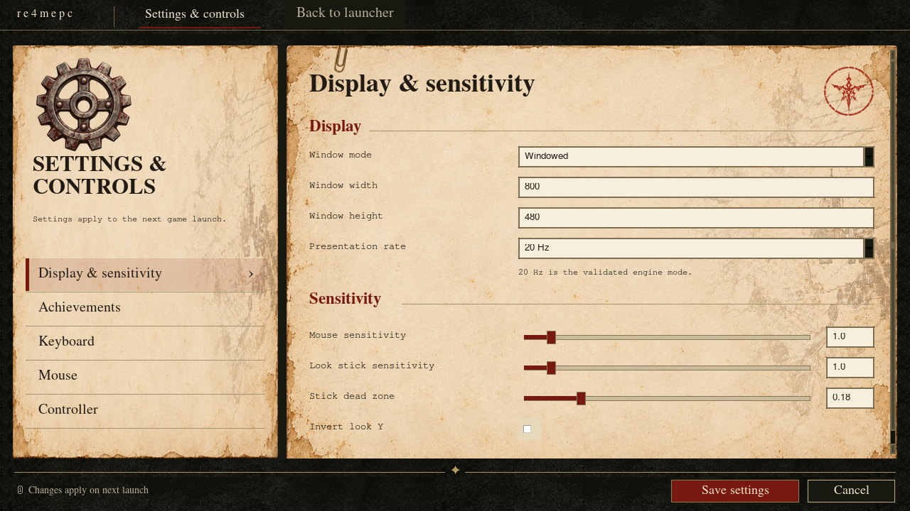
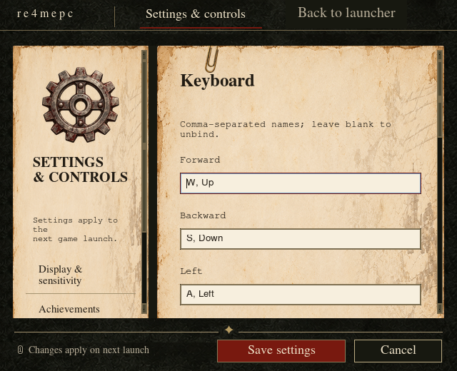
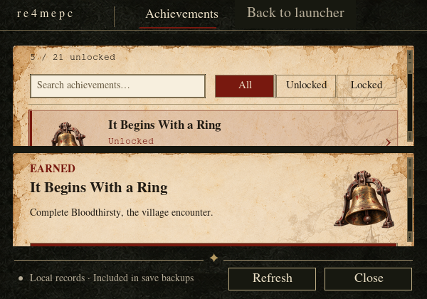
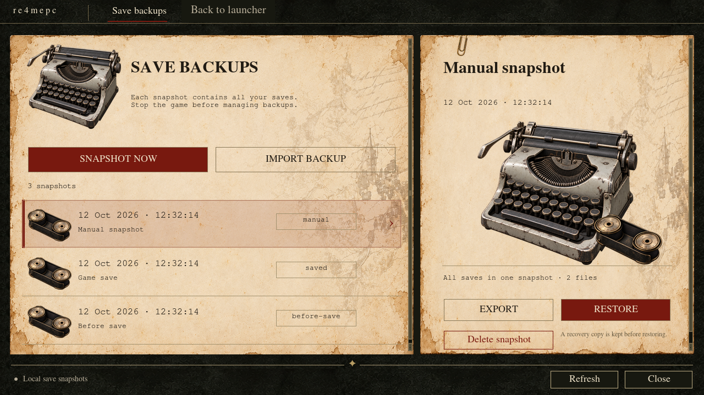
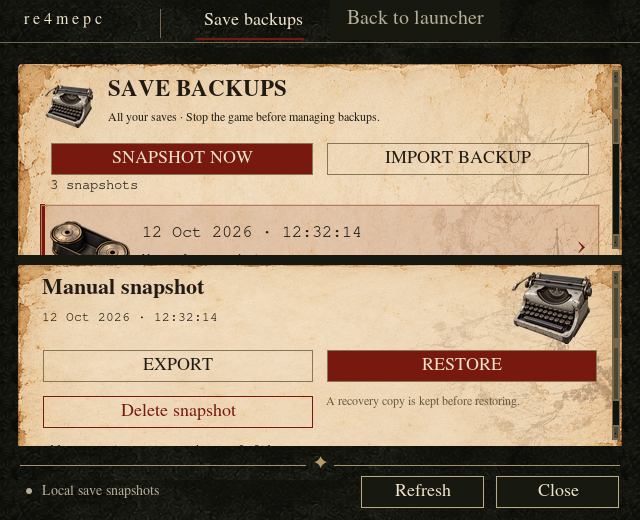

# Native case-file windows

Settings, Achievements and Save backups open as separate native windows from the launcher. Their parchment forms, olive navigation, serif headings and oxblood focus indicators share the launcher palette.

Settings opens at 1280 × 720 and supports 640 × 520. Its six sections preserve every existing setting and binding name. Tab reaches native controls; Up and Down move between section buttons. Focused fields scroll into view. At narrow widths, labels stack above fields. Save validates through the existing settings validator before the atomic write; field errors keep the window open. Cancel, Escape and the window close button confirm unsaved edits. Settings apply to the next game launch, and the validated presentation rate remains 20 Hz.

Achievements opens at 1280 × 720 and supports 600 × 420. Search matches titles and requirements; All / Unlocked / Locked segmented filters preserve catalog order. Tab reaches the search, filter and catalog; arrow keys, Home and End select entries. Ctrl+F focuses Search. Selection reads records without starting the game. Refresh retains the selected visible entry and catalog position. Below 880 pixels wide the catalog stacks above an independently scrolling detail pane. Refresh and Close remain visible.

The mouse wheel moves through the achievement list four entries at a time and selects the first entry in each group, matching `redegpc`. Small trackpad deltas accumulate; wheel input over the search, filters or window chrome leaves the list in place. The detail pane scrolls independently.

The 21 icons use the same artwork for locked and unlocked entries. Explicit state labels and an earned stamp distinguish completions. Missing artwork uses the original drawn badges. Detail displays the existing nanosecond completion timestamp in the computer’s local zone, including seconds and UTC offset. Recovered achievements retain their detection timestamp because their original completion time is unavailable. Record schemas and unlock rules are unchanged.

Screenshot viewing uses a native viewer; Play clip opens the validated local path in the system application. Missing or unsafe captures are identified in the detail pane. Empty searches, empty progress and unreadable records have visible states. Window image caches and pending layout callbacks are released on close.

## Save backups

Save backups opens at 1280 × 720 and supports 640 × 520. The catalog and selected snapshot share the parchment layout of the supplied backup concept. Snapshot now, import, export, restore and delete use stopped-game child operations and the existing installation lock. Restoring confirms replacement and keeps a recovery copy; deleting confirms the dated snapshot and keeps current saves. Busy actions disable across every open backup window. Listings retain selection by snapshot ID, and failures remain visible in the footer. The window keeps the installation it was opened for even if the launcher folder is edited.

At narrow widths, the catalog and detail stack. Compact headings keep search, snapshot/import and selected backup actions visible. Each paper scrolls independently, and focused form fields and catalog rows scroll into view. Back to launcher, Escape and footer Close remain reachable. Sensitivity sliders share values with numeric entries and support arrows, Home and End; Ctrl+S saves settings.

## Reproducing the previews

Synthetic progress and original synthetic captures are created in a temporary directory by `tools/preview_dialogs.py`. No personal gameplay media is used or published. The tiny clip fixture is generated by ffmpeg; published images capture host UI only.

Run `.venv/bin/python tools/preview_dialogs.py` on a desktop with Tk, ffmpeg and ImageMagick’s `import` tool. Captures go into ignored `build/dialog-previews/`, including scrolled, empty-filter and corrupt-record states. The six reviewed default/minimum captures are copied to `docs/`. Run `.venv/bin/python tools/preview_dialogs.py --check` to verify their sizes and provenance documentation.

Run `.venv/bin/python tools/preview_dialogs.py --artwork` to capture all 21 icons on parchment at both 72 and 192 pixels in four native review sheets.

Native interaction checks live in `tests/test_launcher.py`; icon transparency, distinctness, explicit release inclusion and publication hashes are checked in `tests/test_packaging.py`. Headless runners skip native widget checks; a real-display run is required for visual acceptance.
